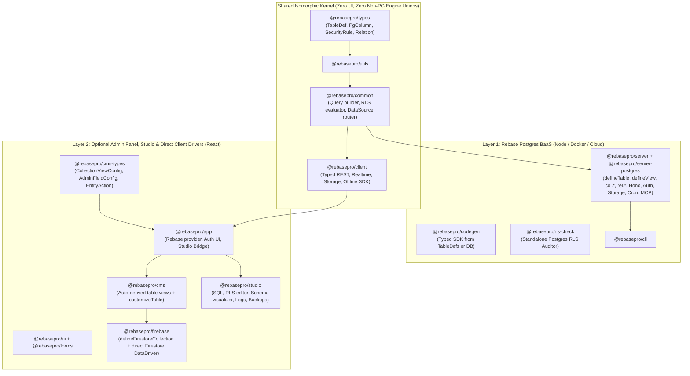
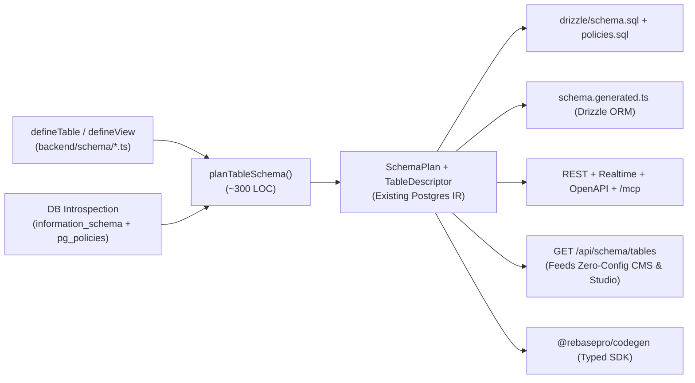

# Rebase Architecture Spec: Postgres-First BaaS Core + Optional CMS Layer

> **Status:** being implemented on branch `feat/postgres-first-baas`. Part I is the
> spec as given (2026-11-12), unchanged except that file links are written as
> paths. Part II records the decisions taken while building it and the checklist
> the work is ticked against.

# Part I — The spec

## 1. Purpose & Non-Negotiable Invariants

Rebase is transitioning from a CMS-originated unified `CollectionConfig` model to a **Postgres-native Backend-as-a-Service (BaaS) for Europe** with an **optional, strictly layered CMS and Studio** on top.

Every design choice in this specification is bound by five invariants:

1. **Zero Loss of Functionality:** Every capability supported today—Postgres column types, generated/identity columns, 5 relation kinds, junction `_pivot` payloads, full-text `tsvector` search, `pgvector` HNSW/IVFFlat indexes, S3/GCS/local storage fields, soft deletes, multi-tenant row stamping, entity history, field/row lifecycle hooks (including PII masking), SQL & materialized views, Studio visual editing, SDK codegen, MCP tools, and custom React CMS views/actions—must work with 1:1 parity.
2. **Mandatory Fail-Closed Security (RLS by Default):** Neither a human developer nor an AI agent may define or serve a Postgres table without an explicit Row-Level Security posture. Security lives in PostgreSQL (`ENABLE ROW LEVEL SECURITY` + `CREATE POLICY` executed under `SET LOCAL ROLE rebase_user`), never in application-memory filters.
3. **Pure Postgres Backend Core:** The backend runtime (`@rebasepro/server` + `@rebasepro/server-postgres`) has zero knowledge of UI labels, form widgets, React components, Firestore subcollections, or MongoDB document emulation. `@rebasepro/server-mongo` is retired.
4. **First-Class Hybrid Postgres + Firestore Support in the CMS:** Client-direct sources (`transport: "direct"`, specifically `@rebasepro/firebase`) remain first-class citizens in the CMS/frontend layer via `resolveDataSource` (`packages/common/src/data/resolveDataSource.ts`), including cross-source references between Firestore documents and Postgres tables.
5. **Automated Migration Path:** Existing `config/collections/*.ts` projects (including `app/` and existing client projects) migrate deterministically via a `ts-morph` codemod in `tooling/scripts/`.

---

## 2. Package & Dependency Topology

> **Important.** The core inversion: **Tables** belong to the BaaS (`backend/schema/`). **Collections** belong to the CMS (`frontend/cms/`). A Postgres table automatically projects into a default CMS collection over the wire with zero frontend config; `frontend/cms/` only states deltas (icons, Kanban, custom React components, enum colors) plus client-only sources like Firestore.



### Structural Cleanups Unlocked Immediately

| Today's Friction | Under This Spec |
|---|---|
| `config/collections/*.ts` shared by Node and Vite; requires `/// <reference types="@rebasepro/cms-types" />` interface merging | **Deleted.** Backend reads `backend/schema/*.ts` (`defineTable`). Frontend optionally reads `frontend/cms/*.tsx` (`customizeTable`) with standard ES imports. |
| Custom React fields require lazy string paths or `() => import(...)` thunks + `pnpm check:headless` loader guards | **Deleted.** `frontend/cms/*.tsx` runs only in Vite/React and imports `<CustomField />` directly by value. |
| `packages/types/src/types/properties.ts` carries `FirebaseProperties`, `MongoProperties`, `DistributiveOmit<..., SqlColumnFields>`, and `type: "string"` for UUIDs | **Deleted from `@rebasepro/types`.** Backend columns map 1:1 to PostgreSQL types (`PgType`, `packages/server-postgres/src/schema/plan/types.ts`). Firestore types move into `@rebasepro/firebase`. |
| `@rebasepro/server-mongo` evaluates partial `securityRules` in JS memory | **Retired.** Every backend data route is backed by real PostgreSQL RLS. |

---

## 3. Project Directory Layout

A project adopts one of two layouts depending on whether it uses the CMS:

```text
# Mode A: Pure BaaS (API + Auth + Storage + Realtime + MCP)
my-backend/
├── backend/
│   ├── schema/               # Optional! Omit for pure DB-introspection mode
│   │   ├── index.ts          # Exports tables + optional defaultRls
│   │   ├── users.ts          # defineAuthTable(...)
│   │   └── posts.ts          # defineTable("posts", ...)
│   ├── functions/            # Custom Hono routes
│   ├── crons/                # Scheduled jobs
│   └── drizzle/              # Generated schema.sql + policies.sql
└── rebase.json

# Mode B: BaaS + Optional CMS / Studio (+ Optional Firestore)
my-app/
├── backend/                  # Identical to Mode A — zero CMS files!
│   └── schema/
├── frontend/
│   └── src/
│       ├── cms/              # Optional UI overrides & direct client collections
│       │   ├── posts.tsx     # customizeTable(posts, { ... }) — real JSX imports allowed
│       │   └── events.ts     # defineFirestoreCollection({ ... }) — client-direct
│       └── App.tsx
└── rebase.json
```

> **Note.** `app/config/` as a third separate TypeScript workspace (`tsconfig.json` + `admin.d.ts` + `frontend-assets.d.ts`) is **no longer needed**. `frontend` can import table symbols (`import type { posts }` or pure schema metadata) from `backend/schema`, while `backend` never imports anything from `frontend`.

---

## 4. Layer 1 Spec: BaaS Schema & Security API (`@rebasepro/server`)

### 4.1 `defineTable`, `defineAuthTable`, and `defineView`

```ts
// backend/schema/posts.ts
import { defineTable, col, rel } from "@rebasepro/server/schema";
import { users } from "./users";
import { tags } from "./tags";

export const posts = defineTable("posts", {
    // Optional overrides (table defaults to "posts", schema defaults to "public", slug defaults to "posts")
    slug: "posts",
    schema: "public",

    columns: {
        id:          col.uuid().primaryKey().defaultRandom(),
        title:       col.text().notNull().validate({ min: 3, max: 200 }),
        slug:        col.varchar(160).notNull().unique(),
        status:      col.enum(["draft", "needs_review", "published", "archived"]).notNull().default("draft"),
        heroImage:   col.storage({ path: "posts/heroes/", accept: ["image/*"], maxBytes: "10MB" }),
        embedding:   col.vector(1536, { index: { method: "hnsw", metric: "cosine" } }),
        metadata:    col.jsonb<{ seoTitle?: string; canonicalUrl?: string }>(),
        publishDate: col.timestamptz(),
        orgId:       col.uuid().notNull(),
        createdAt:   col.timestamptz().notNull().onCreateNow(),
        updatedAt:   col.timestamptz().notNull().onUpdateNow(),
        deletedAt:   col.timestamptz(),
        __order:     col.text(),
    },

    relations: {
        author: rel.belongsTo(() => users, {
            // Creates FK column `author_id` (or binds to an explicit column in `columns`) + btree index
            localKey: "author_id",
            notNull: true,
            onDelete: "restrict",
        }),
        tags: rel.manyToMany(() => tags, {
            through: "posts_tags",
            pivot: {
                addedBy: col.uuid(),
                sortOrder: col.integer().default(0),
            },
        }),
    },

    // MANDATORY: omitting `rls` is a compile-time error AND a boot-time error.
    rls: [
        { operation: "select", access: "public", condition: { status: "published" } },
        { operations: ["select", "insert", "update"], roles: ["editor"] },
        { operation: "delete", roles: ["admin"] },
    ],

    // Built-in Postgres capabilities (1:1 with current PostgresCollectionConfig)
    tenant:     { field: "orgId", from: { claim: "org_id" } },
    softDelete: { field: "deletedAt" },
    history:    true,
    search:     { fields: ["title"], language: "english" },
    indexes:    [{ columns: ["orgId", "status", "publishDate"] }],

    hooks: {
        beforeSave: ({ values, previousValues }) => {
            const merged = { ...previousValues, ...values };
            if (typeof merged.title === "string" && !merged.slug) {
                values.slug = merged.title.toLowerCase().replace(/[^a-z0-9]+/g, "-").replace(/(^-|-$)/g, "");
            }
            return values;
        },
        afterRead: ({ values, context }) => {
            // Full parity with current PII masking (`maskValues`) across REST, Realtime & MCP
            return values;
        },
    },
});
```

### 4.2 Complete Column Builder Surface (`col.*`)

Every member of `PgType` (`packages/server-postgres/src/schema/plan/types.ts`) and every current `Property` capability maps cleanly without UI noise:

| Builder | Postgres Type | Supported Modifiers & Capabilities |
|---|---|---|
| `col.uuid()` | `UUID` | `.primaryKey()`, `.defaultRandom()` (`gen_random_uuid()`), `.notNull()`, `.unique()` |
| `col.text()` | `TEXT` | `.validate({ min, max, matches, email, url, lowercase, trim })`, `.transform({ beforeSave, afterRead })` |
| `col.varchar(n)` / `col.char(n)` | `VARCHAR(n)` / `CHAR(n)` | Same string validations + length enforced at API & DDL |
| `col.enum(values, opts?)` | `CREATE TYPE ... AS ENUM` | Typed literal union `T[number]`; optional shared enum `name` |
| `col.smallint()` / `col.integer()` / `col.bigint()` | `SMALLINT` / `INTEGER` / `BIGINT` | `.identity()` (`GENERATED BY DEFAULT AS IDENTITY`), `.validate({ min, max, integer })` |
| `col.serial()` / `col.bigserial()` | `SERIAL` / `BIGSERIAL` | Legacy serial support for existing schemas |
| `col.real()` / `col.doublePrecision()` / `col.numeric(p?, s?)` | `REAL` / `DOUBLE PRECISION` / `NUMERIC(p,s)` | `.validate({ min, max })` |
| `col.boolean()` | `BOOLEAN` | `.default(true \| false)` |
| `col.timestamptz()` / `col.date()` / `col.time()` | `TIMESTAMPTZ` / `DATE` / `TIME` | `.onCreateNow()`, `.onUpdateNow()` (`BEFORE UPDATE` trigger + driver stamp) |
| `col.jsonb<T>()` / `col.json<T>()` | `JSONB` / `JSON` | Full static TypeScript inference for `T`; optional JSON schema validation |
| `col.array(innerCol)` | `T[]` (e.g., `TEXT[]`, `UUID[]`) | `.validate({ minItems, maxItems, uniqueItems })` |
| `col.vector(dims, opts?)` | `vector(dims)` (`pgvector`) | `{ index: { method: "hnsw" \| "ivfflat", metric: "cosine" \| "l2" \| "ip" } }` |
| `col.bytea()` | `BYTEA` | Base64/binary wire codec preserved |
| `col.geopoint()` | `JSONB` / tuple `{ lat, lng }` | Preserves existing geopoint wire compatibility |
| `col.storage(opts)` | `TEXT` (or `TEXT[]` with `.multiple()`) | `{ source, path, accept, maxBytes, imageResize }` — binds directly to S3/GCS/Local storage lifecycle, orphan sweeps, and signed URLs |

**Universal column modifiers on every `col.*`:**

* `.column("legacy_col_name")` — overrides default `snake_case(key)` SQL column mapping while keeping `key` as the JSON/SDK property name.
* `.notNull()` — Columns are **nullable by default** (matching SQL and Drizzle conventions!) unless `.notNull()` or `.primaryKey()` is called. *(Note: eliminates today's confusing `validation: { required: true }` vs SQL `NOT NULL` split.)*
* `.unique()` — Single-column unique constraint.
* `.default(literal)` / `.defaultSql("gen_short_id()")` — Compiles directly to `ColumnDefault` (`packages/server-postgres/src/schema/plan/types.ts`).
* `.generatedAs(sqlExpr)` — `GENERATED ALWAYS AS (...) STORED`.
* `.readOnly()` — Rejects client writes on `create`/`update` at the API boundary (while allowing DB defaults/triggers).
* `.transform({ beforeSave, afterRead })` — Field-level hooks (e.g. `value.trim()`), preserving today's `PropertyCallbacks`.

### 4.3 All 5 Relations (`rel.*`)

All five relation kinds in `packages/types/src/types/relations.ts` are preserved verbatim with circular-import-safe target thunks:

* `rel.belongsTo(() => target, { localKey?, notNull?, onDelete?, onUpdate?, index? })` — Declares or binds to a local FK column; auto-creates btree index unless `index: false`.
* `rel.hasOne(() => target, { foreignKey })` — Target table holds unique FK.
* `rel.hasMany(() => target, { foreignKey, orderBy? })` — Target table holds FK.
* `rel.manyToMany(() => target, { through?, sourceKey?, targetKey?, pivot? })` — Auto-provisions junction table + RLS on junction table + `_pivot` read/write support.
* `rel.via(() => target, { steps: [...] })` — Multi-hop read-only traversal.

### 4.4 Mandatory Security Model (`rls` by Default)

> **Warning — Security Invariant:** A table can never accidentally become public or unprotected. Every path into Rebase enforces RLS fail-closed.

1. **In `defineTable`:** `rls` is a **required property** on the TypeScript interface (not optional!). Three explicit values are accepted:
   * `rls: "admin-only"` — Enables RLS on the table and generates only the baseline `default_admin` policy (only `admin` role and server-internal `dataAsAdmin` can access rows; ordinary authenticated and anonymous callers get 0 rows / 403).
   * `rls: [ ...SecurityRule[] ]` — Explicit permissive/restrictive rules (`ownerField`, `access: "public" | "authenticated"`, `roles`, structured `condition`/`check`, or raw SQL `using`/`withCheck` with `rebase.uid()`, `rebase.roles()`, `rebase.jwt()`).
   * `rls: "inherit"` — Explicitly opts into `defaultRls` exported from `backend/schema/index.ts`. (If `"inherit"` is used and `backend/schema/index.ts` exports no `defaultRls`, `rebase db generate` and server boot fail hard.)
2. **In `defineAuthTable`:** Automatically injects self-read (`id = rebase.uid()`) and admin-only privilege-column protection (`roles` cannot be self-escalated), matching today's auth table guarantees.
3. **In `defineView`:**
   * Standard view (`materialized: false`): Created with `WITH (security_invoker = true)` so underlying base tables' RLS policies govern every query automatically.
   * Materialized view (`materialized: true`): Requires explicit `roles: string[]` (defaults to `["admin"]`) since Postgres cannot attach row policies to materialized views.
4. **In Zero-Config DB Introspection Mode (no `backend/schema/`):** Unchanged from `docs/MODULAR-ARCHITECTURE.md`—any table without `ENABLE ROW LEVEL SECURITY` is skipped at boot and prints the exact `ALTER TABLE ... ENABLE ROW LEVEL SECURITY` remediation SQL.

---

## 5. Compiler & Wire Bridge (Why Nothing Breaks Internally)

Because `packages/server-postgres/src/schema/plan/types.ts` already isolated a clean `SchemaPlan` (`TablePlan`, `ColumnPlan`, `PgType`, `ForeignKeyPlan`), **95% of `@rebasepro/server-postgres` stays intact**:



### Public Schema Metadata Endpoint (`GET /api/schema/tables`)

For authenticated callers (or Studio/CMS), the backend exposes its normalized `TableDescriptor[]` JSON (columns, `PgType` tags, nullability, enum literals, storage rules, relations, and structured `rls` expressions—never server hook source code).

This single wire payload powers **three** consumers with zero duplicate config files:

1. **Zero-Config `<RebaseCMS />`** — Renders every Postgres table immediately without a single frontend config file.
2. **`<RebaseStudio />`** — Renders the Schema Visualizer, SQL autocomplete, API Explorer, and RLS Policy Editor.
3. **Hosted & Local MCP (`show_collection` / `@rebasepro/mcp-apps`)** — Renders interactive table/form UIs inside Claude directly from the table descriptor.

---

## 6. Layer 2 Spec: Optional CMS & Hybrid Firestore Support

### 6.1 Zero-Config Defaults (Postgres Tables -> CMS Views)

When `<RebaseCMS />` mounts connected to `rebaseClient`, every table from `GET /api/schema/tables` automatically receives sensible UI defaults:

* **Labels:** `first_name` / `firstName` -> `"First Name"`; table `order_items` -> `"Order Items"` (singular `"Order Item"`).
* **Widgets from `PgType` + Metadata:**
  * `col.text()` / `col.varchar()` -> Text input (or URL/Email input if `.validate({ url: true })` / `{ email: true }`)
  * `col.enum([...])` -> Select / Status badge chip (deterministic palette color assigned per enum value unless overridden)
  * `col.storage(...)` -> Drag-and-drop upload field with preview & accept/size validation
  * `col.timestamptz()` / `col.date()` -> Date-time / Date picker (`createdAt`/`updatedAt` auto-marked `readOnly` & hidden from default table columns)
  * `col.jsonb()` -> Structured JSON editor
  * `rel.belongsTo` / `rel.manyToMany` -> Relation reference picker & entity drawer sub-tabs (`hasMany` / `manyToMany`)
* **Client-Side Permission Reflection:** Structured `rls` rules are evaluated client-side (using your existing policy evaluator) so "Create", "Edit", and "Delete" controls hide automatically when the signed-in role lacks permission.

### 6.2 Customizing Postgres Tables in the CMS (`customizeTable`)

When a project wants rich back-office ergonomics (like `app/config/collections/posts.ts`), it adds a frontend-only file in `frontend/src/cms/`:

```tsx
// frontend/src/cms/posts.tsx
import { customizeTable, updateRecord } from "@rebasepro/cms";
import type { posts } from "../../../backend/schema/posts";
import { CustomMarkdownEditor } from "../components/CustomMarkdownEditor";

export const postsCms = customizeTable<typeof posts>("posts", {
    name: "Blog Posts",
    singularName: "Blog Post",
    icon: "FileText",
    group: "Content",

    // View modes
    defaultViewMode: "cards",
    enabledViews: ["table", "cards", "kanban"],
    kanban: { columnField: "status", orderField: "__order" },

    // Card / List slot mapping
    display: {
        title: "title",
        image: "heroImage",
        status: "status",
        date: "publishDate",
    },

    // Per-column UI overrides (type-checked against `typeof posts` columns & relations!)
    fields: {
        status: {
            // UI presentation labels & colors live HERE in the CMS, not in the DB schema!
            enumLabels: {
                draft:        { label: "Draft", color: "gray" },
                needs_review: { label: "Needs Review", color: "orange" },
                published:    { label: "Published", color: "green" },
                archived:     { label: "Archived", color: "red" },
            },
        },
        title:   { multiline: true },
        content: { Field: CustomMarkdownEditor }, // Direct React component import!
        orgId:   { hidden: true },
        __order: { hidden: true, disabled: true },
    },

    // Custom toolbar / row actions
    entityActions: [
        {
            key: "publish",
            name: "Publish",
            icon: "Send",
            collapsed: false,
            isEnabled: ({ row }) => row?.status !== "published",
            onClick: ({ id, context }) =>
                updateRecord(context, "posts", id, { status: "published", publishDate: new Date().toISOString() }, "Published"),
        },
    ],
});
```

### 6.3 First-Class Hybrid Postgres + Firestore (`@rebasepro/firebase`)

Your client project running **both Postgres and Firestore** works cleanly without leaking a single Firestore type into `@rebasepro/server`:

1. **`@rebasepro/firebase` owns `defineFirestoreCollection`:**
   * Supports Firestore-native concepts: `path`, `subcollections: () => [...]`, `FirebaseProperties` (`string`, `number`, `boolean`, `date`, `map`, `array`, `geopoint`, `reference`), and Firestore security-rule awareness.
2. **Unified Mounting & Cross-Engine References in `<Rebase>`:**

```tsx
// frontend/src/App.tsx — Hybrid Postgres + Firestore App
import { Rebase, RebaseAuth } from "@rebasepro/app";
import { RebaseCMS, RebaseShell } from "@rebasepro/cms";
import { RebaseStudio } from "@rebasepro/studio";
import { useFirestoreDataSource, defineFirestoreCollection } from "@rebasepro/firebase";
import { postsCms } from "./cms/posts";

const firestoreEvents = defineFirestoreCollection({
    slug: "fs_events",
    path: "events",
    name: "Live Events (Firestore)",
    dataSource: "firestore",
    fields: {
        type:       { name: "Event Type", type: "string", required: true },
        payload:    { name: "Payload", type: "map" },
        // Cross-engine reference! Points to the `users` Postgres BaaS table:
        customerId: { name: "Customer", type: "reference", target: "customers" },
    },
    subcollections: () => [eventTracesFirestoreCollection],
});

export function App() {
    const firestoreSource = useFirestoreDataSource({ key: "firestore", firebaseApp });

    return (
        <Rebase
            client={rebaseClient}          // Default data source → Postgres BaaS
            dataSources={[firestoreSource]} // Secondary direct data source → Firestore
            authController={authController}
        >
            <RebaseAuth />
            <RebaseCMS
                // Auto-discovers all Postgres tables from `rebaseClient`, merges `postsCms`,
                // and mounts `firestoreEvents` side-by-side in the same navigation & reference router!
                tableCustomizations={[postsCms]}
                externalCollections={[firestoreEvents]}
            />
            <RebaseStudio />
            <RebaseShell title="Acme Ops" />
        </Rebase>
    );
}
```

* When an operator opens `fs_events` (Firestore) and clicks the `customerId` reference chip, `resolveDataSource("customers", registry)` (`packages/common/src/data/resolveDataSource.ts`) routes that lookup to `rebaseClient` (Postgres BaaS under RLS).
* Conversely, a Postgres table with a `col.text()` holding a Firestore document ID can be decorated in `customizeTable` with `fields: { firestoreDocId: { referenceTo: "fs_events" } }`, routing the preview drawer to `firestoreSource`!

### 6.4 Studio Visual Schema Editor (`SchemaSourceEditor`)

Today, `SchemaSourceEditor` (`packages/server/src/schema-edit/source-editor.ts`) uses `ts-morph` to mutate `config/collections/*.ts` with both SQL schema edits and `admin: { ... }` UI tweaks.

Under the split:

* **`/api/schema-editor/*` (Backend AST Editor)** reads and writes **`backend/schema/*.ts` (`defineTable` / `rls` / `col.*` / `rel.*`) only**. Because `defineTable` is a flat, regular builder DSL without JSX/thunks/enum colors, the `ts-morph` writer becomes dramatically simpler and more reliable.
* **UI Layout Persistence** (column widths, hidden columns, default view mode changed in Studio) either writes to a clean JSON/TS UI config in dev mode or persists to user/workspace view preferences in `rebase.ui_preferences` when running in deployed/headless environments where frontend source files aren't on disk!

---

## 7. Complete Capability Parity Check

| Capability | Current (`CollectionConfig`) | New Spec (`defineTable` + `customizeTable`) | Status |
|---|---|---|---|
| Postgres DDL & Drizzle `schema.generated.ts` | `planSchema(collections)` | `planSchema(tables)` (same `SchemaPlan` IR) | **100% Parity** |
| Fail-closed Postgres RLS + `policies.sql` | Optional `securityRules` + directory fallback | **Required** `rls` key (`"admin-only"` \| `"inherit"` \| `SecurityRule[]`) | **Stronger** |
| Headless DB Introspection (`--headless`) | `introspectCollections` | `introspectTables` (refuses tables without RLS) | **100% Parity** |
| All 5 Relations + `_pivot` + `_count` | `Property(relation)` + `relations[]` | Unified `relations: { ... }` block with `rel.*` | **Cleaner, 100% Parity** |
| Multi-tenancy (`tenant`), `softDelete`, `history` | Top-level keys on `PostgresCollectionConfig` | Top-level keys on `defineTable` | **100% Parity** |
| Full-text `search` (`tsvector`) & `pgvector` | `search` + `VectorProperty` | `search` + `col.vector(dims, opts)` | **100% Parity** |
| S3/GCS Storage uploads, resizing & orphan sweep | `StringProperty.storage` | `col.storage({ ... })` | **100% Parity** |
| Row & Field Hooks + PII Masking | `callbacks` + `Property.callbacks` | `hooks` + `col.transform(...)` | **100% Parity** |
| SQL Views & Materialized Views | `PostgresCollectionConfig.view` | Dedicated `defineView(name, { query, materialized, roles })` | **Cleaner, 100% Parity** |
| Auth Tables (OAuth, MFA, Magic Link, API Keys) | `auth: true \| AuthCollectionConfig` | `defineAuthTable("users", { ... })` | **Cleaner, 100% Parity** |
| Typed SDK Codegen (`rebase generate-sdk`) | Reads `config/collections` | Reads `backend/schema` (or live DB introspection) | **100% Parity** |
| Remote `/mcp`, Local MCP, `plugin-review`, `mcp-apps` | Built on REST/DataDriver + RLS | Unchanged; operates on `TableDescriptor` under RLS | **100% Parity** |
| Kanban, Spreadsheet, Cards, Custom React Fields/Actions | `admin: { ... }` with lazy import thunks | `customizeTable` in `frontend/` with native React imports | **Simpler, 100% Parity** |
| Hybrid Postgres + Firestore App | Shared `CollectionConfig` union | `defineTable` (PG) + `defineFirestoreCollection` (`@rebasepro/firebase`) | **100% Parity** |

---

## 8. Phased Execution Plan & Migration Codemod

> **Tip.** Because `defineTable` compiles to the exact same internal `TablePlan` / `SchemaPlan` and runtime driver structures, we do **not** need a risky "big bang" rewrite. We can ship this in 4 clean, verifiable phases.

1. **Phase 1 — Retire `@rebasepro/server-mongo` & Isolate Firestore to `@rebasepro/firebase`:**
   * Remove `packages/server-mongo` and strip `MongoProperties` / `MongoDBCollectionConfig` from `@rebasepro/types`.
   * Move `FirebaseCollectionConfig`, `FirebaseProperties`, and `subcollections` out of `@rebasepro/types` into `@rebasepro/firebase` + `@rebasepro/cms-types`.
2. **Phase 2 — Ship `defineTable`, `defineAuthTable`, `defineView`, `col.*`, `rel.*`:**
   * Implement the `defineTable` builder in `@rebasepro/types` / `@rebasepro/server` with mandatory `rls`.
   * Write the ~300-line adapter from `TableDef` -> `SchemaPlan` + runtime `TableDescriptor` (`GET /api/schema/tables`), keeping full test coverage across `server-postgres` and `rls-check`.
3. **Phase 3 — Ship Zero-Config `<RebaseCMS />` + `customizeTable` + Codemod:**
   * Teach `@rebasepro/cms` to hydrate default collections from `GET /api/schema/tables`, layered with `tableCustomizations={[...]}` and `externalCollections={[...]}`.
   * Build `tooling/scripts/migrate-collections-to-tables.mts` (`ts-morph`): automatically splits any existing `config/collections/*.ts` file into `backend/schema/<table>.ts` (`defineTable`) + `frontend/src/cms/<table>.tsx` (`customizeTable`, emitted *only* if the collection actually had non-default `admin` customizations!) + `defineFirestoreCollection` for `engine: "firestore"`.
   * Run the codemod on `app/` and verify all unit + Playwright E2E lanes pass.
4. **Phase 4 — Remove Legacy `defineCollection` Backend Loader & Headless Guards:**
   * Update CLI templates (`rebase init` and `rebase init --headless`), `SchemaSourceEditor`, SDK codegen, docs, and `llms.txt`.
   * Delete obsolete React-in-backend guard complexity (`admin.d.ts` declaration merging, Vite string-to-lazy-import rewriter).

---

## 9. Open Decisions for Review

1. **Naming of the BaaS entry point & package:**
   Should `defineTable`, `col`, `rel` be imported from `@rebasepro/server/schema` (keeping package names unchanged per repo rules), or from `@rebasepro/types` / `@rebasepro/common` so isomorphic tools can import schema files without installing `@rebasepro/server`? *(Recommendation: `@rebasepro/types` or `@rebasepro/common`, re-exported by `@rebasepro/server`, so `frontend` or `codegen` can import `typeof posts` with zero server runtime deps.)*
2. **Drizzle Interop vs. `defineTable`:**
   Do you like the dedicated `defineTable` + `col.*` builder shown in §4.1 (which keeps `rls`, `storage`, `tenant`, `hooks`, `search`, and `vector` in one cohesive TypeScript object), **or** would you prefer users to write raw Drizzle `pgTable(...)` for columns and pass that `pgTable` into `defineTable(postsTable, { rls, hooks, storage, ... })`?
3. **BelongsTo Foreign Key Style:**
   In `defineTable`, do you prefer declaring foreign keys inside `relations: { author: rel.belongsTo(() => users) }` (which generates `author_id` automatically), or right inside `columns: { authorId: col.belongsTo(() => users).notNull() }` so every physical column on the table is visible in `columns`?

---

# Part II — Decisions and checklist

Every entry names what was decided and why. Entries marked **(gap)** add
something the spec's surface does not show, because invariant 1 (zero loss)
cannot hold without it; they are additions in the spec's own style, never
substitutions. Entries marked **(unsure)** are the ones to review first.

## A. The three open decisions (§9)

- **D1 — entry point.** The builders (`defineTable`, `defineAuthTable`,
  `defineView`, `col`, `rel`, `json`) and every authoring/wire type live in
  `@rebasepro/types` (dependency-free, isomorphic). The compiler
  (`TableDef → TableDescriptor`) lives in `@rebasepro/common`, because it needs
  the naming helpers in `@rebasepro/utils`. `@rebasepro/server` re-exports the
  builders from its root and from the subpath `@rebasepro/server/schema` (a tiny
  entry that loads nothing of the server), so the spec's import line works
  verbatim and a frontend can `import type { posts }` with no server runtime.
- **D2 — builder.** The dedicated `defineTable` + `col.*` builder of §4.1. No
  Drizzle `pgTable` interop.
- **D3 — foreign keys.** Declared in `relations: { author: rel.belongsTo(...) }`
  as in §4.1. A `belongsTo` *binds* to a column in `columns` whose SQL name is
  its `localKey` when one exists, and otherwise *derives* the column (appended
  after the declared ones, wire key = camelCase of the column, as today). The
  codemod always writes the bound column explicitly at its original position,
  so migrated projects generate byte-identical SQL and every physical column is
  visible in `columns`.

## B. Authoring surface — the complete contract

Column spelling follows Drizzle's pg-core since 2026-11-13 — see `drizzle-alignment`.

Authoritative source: `packages/types/src/schema/`. Summary:

### `defineTable(name, config)`

| Key | Meaning |
|---|---|
| `name` (1st arg) | Default for both the SQL table and the API slug. |
| `table?`, `slug?`, `schema?` | Overrides. `schema` defaults to `public`. The codemod writes `slug` whenever it differed from the table: foreign-key and junction names derive from the slug today and must not move. |
| `database?` **(gap)** | Key of a non-default Postgres database declared in `backend/resources.ts` (was `dataSource`). |
| `description?` **(gap)** | Shown in OpenAPI and MCP tool descriptions (was `name`/`description`). Not a UI label. |
| `columns` | `col.*` builders, in physical order. At least one `.primaryKey()`; several make a composite key in declaration order. No implicit `id` column any more. |
| `relations?` | `rel.*` builders; the key is the relation name. |
| `rls` | **Required.** `"admin-only"`, `"inherit"`, or a non-empty `SecurityRule[]`. `[]` is refused: say `"admin-only"`. |
| `defaultPolicies?: false` **(gap)** | Explicit rules *without* the injected admin baseline (was `disableDefaultPolicies`). Refused together with `"admin-only"` (that would deny everyone). |
| `tenant?`, `softDelete?`, `history?`, `search?`, `indexes?` | As today. `indexes[].columns` (spec name) replaces `on`; each entry is a column key or `{ column, direction?, nulls? }`; `where`, `unique`, `using`, `include`, `reason` unchanged. |
| `hooks?` | All seven: `beforeQuery`, `afterRead`, `beforeSave`, `afterSave`, `afterSaveError`, `beforeDelete`, `afterDelete`. Props carry `table` (the descriptor) instead of `collection`; `afterRead` receives `values`. |
| `strictWrites?: false` **(gap)** | Accept writes to columns the table does not declare (was `strictWrites`). |
| `metadata?` **(gap)** | Opaque, served on the wire. |

`defineAuthTable(name, config)` = the same plus `auth?: { roles, scopes,
personalKeys, onCreateUser, onResetPassword }`; injects self-read, the
admin-write gate and the auth columns. `defineView(name, { query, materialized?,
roles?, columns, schema?, slug?, indexes? })`.

### `col.*`

Every builder of §4.2, plus `col.smallserial()` (it is a `PgType` member),
spelled as Drizzle's `pg-core` spells it: an optional SQL column name first,
then Drizzle's config object, then the chain. §4.2's spellings map to:

| §4.2 | Canonical |
|---|---|
| `.column("legacy_col_name")` | the builder's leading argument: `col.text("legacy_col_name")` |
| `col.varchar(n)` / `col.char(n)` | `col.varchar({ length: n })` / `col.char({ length: n })` — the length is required |
| `col.enum(values, { name })` | `const status = pgEnum(name, values)`, then `status()`; `col.enum(values)` (type `<table>_<column>`) unchanged |
| `col.bigint()` / `col.bigserial()` | `col.bigint({ mode: "number" })` / `col.bigserial({ mode: "number" })` |
| `col.numeric(p?, s?)` | `col.numeric({ precision, scale })` (`col.decimal` is an alias) |
| `col.timestamptz()` | `col.timestamp({ withTimezone: true })` |
| `col.jsonb<T>()` / `col.json<T>()` | `col.jsonb().$type<T>()` / `col.json().$type<T>()` |
| `col.array(innerCol)` | `innerCol.array()` — item rules before `.array()`, column modifiers after |
| `col.vector(dims, opts?)` | `col.vector({ dimensions, index? })` |
| `.defaultSql("gen_short_id()")` | `` .default(sql`gen_short_id()`) ``; `.defaultNow()` is `` .default(sql`now()`) `` |
| `.generatedAs(sqlExpr)` | `` .generatedAlwaysAs(sql`…`) `` |
| `.identity()` | `.generatedByDefaultAsIdentity()` |
| — | `col.custom({ dataType: "inet" })` for a type no builder names |

A Drizzle spelling that would mean something else here does not compile, with
a message saying what to write (`col.timestamp()` without time zone,
`.references()` — a foreign key is a `rel.belongsTo` —, `.$defaultFn()`,
`.generatedAlwaysAsIdentity()`, `numeric`'s `mode: "string"`, …).

Universal modifiers of §4.2, plus **(gap)**:

| Modifier | Replaces |
|---|---|
| `.access({ read?, write? })` | `access` — per-role column access, enforced on every door. |
| `.private()` | `excludeFromApi` — never on the wire, in the SDK or in OpenAPI. |
| `.onCreateUser()` / `.onUpdateUser()` | `autoValue: "user_on_create" \| "user_on_update"`. |
| `.dbDefault()` | `databaseDefault: true` — the database owns a default Rebase does not state. |
| `.describe(text)` | Column description for OpenAPI/MCP. |
| `.oneOf([...])` | A closed value set that is *not* a Postgres enum type, on a number column. On text it is Drizzle's `col.text({ enum: [...] })`, also for `TEXT[]` of known strings (`col.text({ enum: [...] }).array()`). |
| `.validate({...})` extras | `length`, `uppercase`, `lessThan`, `moreThan`, `positive`, `negative`, date `min`/`max`, `requiredMessage`, `matchesMessage`, `uniqueItems`. |
| `col.vector({ dimensions, index })` | `index.metric` may be an array (one index per metric); `m`, `efConstruction`, `lists` kept; `index: false` kept. `"ip"` is today's `inner_product`. |
| `col.storage({...})` extras | `public`, `fileName` (template), `metadata`, `includeBucketUrl`, `storeUrl`. Browser-only options (`processFile`, `postProcess`, `previewUrl`, function-valued paths) move to `customizeTable`. |

`.notNull()` is exactly today's `validation.required` (NOT NULL and "required"
in the API). `.default(v)` is a DDL default *and* applied by the driver, as
today. Stamp columns stay nullable unless `.notNull()` is written.

### `json.*` **(gap)** — nested JSON shapes

`col.jsonb().$type<T>()` types a document statically; `col.jsonb(json.object({...}))`
also tells the server its shape, which today's nested `map.properties`,
`array.of` and `array.oneOf` do: per-field validation, defaults, stamps,
transforms, storage files inside blocks, search over JSON paths. Builders:
`json.object`, `json.array`, `json.oneOf` (typed blocks: `typeField`,
`valueField`, `variants`), `json.string`, `json.number`, `json.boolean`,
`json.date`, `json.geopoint`, `json.storage`, `json.unknown`; modifiers
`.required()`, `.validate()`, `.default()`, `.oneOf()`, `.onCreateNow()`,
`.onUpdateNow()`, `.onCreateUser()`, `.onUpdateUser()`, `.userId()`,
`.transform()`. A document's top may be an object, an array, a scalar or a
`json.oneOf`; `json.oneOf` and `json.unknown()` may sit at any depth, and
stamps apply at any depth. `json.array(json.object({...})).validate({ uniqueBy:
[...] })` **(gap)** carries the field-level `uniqueInArray`.

### `rel.*`

As §4.3, plus **(gap)**: `sourceKey` on `hasOne`/`hasMany` (natural keys);
`unique` on `belongsTo`; `onDelete` on `manyToMany`; `cardinality` on `via`.
`orderBy` on `hasMany` is new with the spec: the order an include, a
single-parent relation read and a nested listing use when the caller names
none. A caller's `orderBy` replaces it rather than extending it, the target's
key ascending always ends it, and a per-parent include `limit` keeps the first
rows of it. Relation names are matched exactly (no slug or snake_case retry).

### `rls`

`SecurityRule` is today's type, verbatim — policy names are a hash of the rule
as written, so a migrated rule must not be reshaped by a single key. Two forms
the spec's example uses are added as *new* shapes with their own compilation:
a plain-object `condition`/`check` (`{ status: "published" }` = equality on
each key), and `access: "public" | "authenticated" | "registered"` combined
with `condition` / `check`. `"registered"` **(gap)** is `"authenticated"`
without anonymous guests. The compiler refuses every pair of clauses the
`SecurityRule` union excludes and any invalid `access` / `mode` /
`operation(s)` / `roles` value, so a cast or plain JavaScript cannot compile a
rule that silently drops a clause.

## C. Project layout

- `backend/schema/index.ts` exports the tables and views, and optionally
  `defaultRls`. Index exports are authoritative; a `defineTable` in a sibling
  file that `index.ts` does not export is a boot and generate error.
- What else lived in `config/`: `backend/resources.ts` (databases, buckets,
  topics), `backend/storage.ts` (`storageAuthorize`), `backend/hooks.ts`
  (`hooks`: global table hooks), `backend/generated/register.ts`.
  `setCollectionCallbacks` becomes `setTableHooks(slug, hooks)`.
- `rebase.json`: new key `tables` (default `backend/schema`). `schema` keeps
  meaning the generated Drizzle file. Bundle manifest: `entry.tables`; bundle
  format 3, runtime contract 2. Older bundles are refused with a message that
  names the codemod.
- `frontend/src/cms/*.tsx` holds `customizeTable(...)` and
  `defineFirestoreCollection(...)`. The frontend imports `backend/**` as types
  only: `rebaseBackendGuard()` (`@rebasepro/app/vitePlugin`) fails `vite build`
  and `vite dev` on a value import, and `rebase build` refuses a frontend whose
  Vite config lacks it. This replaces what the Vite collections plugin did to
  keep server hooks out of the browser bundle.
- `frontend/src/cms/ui-config.json` holds the workspace's presentation saved in
  development; `rebase build` ships it in the bundle (`entry.uiConfig`).

## D. Inside the backend

- One internal model: `TableDescriptor` (wire-safe, Postgres-native columns)
  wrapped in a server-only `RuntimeTable` (descriptor + catalogue table + hooks
  + transforms). `GET /api/schema/tables` serves the descriptors, redacted per
  caller.
- The work is staged so the tree is green after every stage:
  1. **Stage A — the new front door.** `defineTable` compiles to a descriptor
     and is *lowered* into the planner's and runtime's current input, so SQL
     generation, boot and every route work unchanged. Golden files recorded
     from `main` prove byte-identical output. Loader, CLI, wire endpoint, CMS
     projection, `customizeTable`, Firestore isolation, codemod, templates,
     cloud and docs all build on this.
  2. **Stage B — the inside.** The runtime, the server and the planner move
     onto descriptors subsystem by subsystem (done: no runtime path lowers a
     table any more). Legacy test fixtures stay collection literals and are
     *lifted* through `@rebasepro/common/migrate` (see G); the CMS view-model
     types (`Property`, CMS `CollectionConfig`) move to `@rebasepro/cms-types`,
     Firestore's to `@rebasepro/firebase`; the lowering is then deleted and
     the kernel exports no legacy type. The lift stays, as migration tooling
     only, in `@rebasepro/common/migrate`.
- The schema-version hash is computed over descriptors, so every project
  restamps once and every generated SDK is reported stale once.
- **One read shape and one write shape — both done.** REST, the SDK, the socket's
  one-shot frames and subscriptions, MCP, the RLS simulator and the Postgres
  driver's own `fetchCollection` / `fetchOne` return the same row: columns
  under their keys, a foreign key as a key, RFC 3339 timestamps, numeric as
  numbers, a native array's items decoded like their scalar type, and a
  relation only when `include` names it (as the target's own row). No
  response carries a `{ __type }` envelope; the client parses responses as
  plain JSON and revives no class; history entries are wire rows (older
  envelopes are served as plain values). The admin panel never read the
  envelope from the socket: it reads REST through `client.data` and builds its
  view model in the browser (`toViewModelValues`, `collectionEntityDataOptions`
  in `@rebasepro/cms-types`). The kernel (`@rebasepro/types`,
  `@rebasepro/common`, `@rebasepro/server`) exports no view-model type. The view-model builders of the driver
  (`parseDataFromServer`, `normalizeDbValues`, `toFlatRow`) are deleted.
  Writes take the same shape: REST, the socket, MCP and the in-process SDK
  accept the values the REST API documents (a to-one relation as its key or
  `null`, a to-many as keys or `{ id, _pivot? }`, a vector as numbers, a point
  as `{ latitude, longitude }`, a date as ISO text) and nothing else, and a
  relation filter compares the key. The admin converts its view model to wire
  values in the browser before every write and filter (`viewModelToWire`,
  `wireValuesOf` / `wireFilterValueOf`); the value classes (`EntityRelation`,
  `GeoPoint`, `Vector`, …) live in `@rebasepro/cms-types`; the offline queue
  stores wire values (layout 2) and converts entries the previous version
  queued.

## E. Things to review first (unsure)

1. **Branch, not `main`.** A push of `main` deploys the control plane, and this
   is a breaking change to every layer, so the work is on
   `feat/postgres-first-baas` (OSS and cloud repos), unpushed.
2. **Deployed tenants.** A tenant bundle built from `config/collections` does
   not boot on the new runtime; it must be rebuilt after running the codemod on
   its source. Nothing was deployed.
3. **Version.** Templates may only import what the pinned release exports, so
   the workspace version is bumped on the branch (no tag, no publish).
4. **Translations.** Rewritten docs pages lose their five translated copies
   (English is served as fallback) until they are re-translated, which needs
   the translation key in `website/.env`.
5. Every **(gap)** name above.

## F. Checklist

Filled by an independent parity review at HEAD on 13 Nov 2026. The lines still open are the release and rollout, and the
items only a full verification run covers (the Playwright lane, `pnpm ci:e2e`, the cloud control plane's own program).

Worktree `/Users/francesco/rebase/.claude/worktrees/pgfirst`, HEAD `38df6df65c` (559 commits on `main` = `7081747fad`).
Uncommitted at review time: locale docs + `tooling/scripts/locale-sources.json` (background locale run); no product source.

Marks: `[x]` proven (where + a test I RAN green at HEAD, or a probe I ran) · `[~]` done with a recorded deviation (Part II G line
named) · `[ ]` not met (what is missing) · `[?]` could not verify here (why) — added marker, not counted as `[ ]`.
"ran" = I ran that file at HEAD in this review (jest/vitest, `--maxWorkers=2`; Docker e2e through `locked.sh heavy`).

### §1 Invariants
- [x] 1.1 Every `PgType` — `col.*` in `packages/types/src/schema/columns.ts:998` (all spec rows + interval/inet/cidr/macaddr/point/line/halfvec/sparsevec/bit/custom). Proof: `server-postgres/test/plan-golden.test.ts` (ran; property-matrix + 11 real corpora byte-identical, `PLAN_GOLDEN_ALLOWED_DIFFERENCES = []`), `server-postgres/test/codecs-native-tables.test.ts`, `wire-read-values.test.ts` (ran).
- [x] 1.2 Generated + identity — `.generatedAlwaysAs()`, `.generatedByDefaultAsIdentity()` (Drizzle spelling; `generatedAlwaysAsIdentity` refused). Proof: `types/test/schema/drizzle-spelling.test.ts` (ran, ts-jest type-checked), `common/test/schema/compile-tables.test.ts` (ran), plan-golden (ran).
- [x] 1.3 Five relation kinds incl. self-relation — `rel.*` `packages/types/src/schema/relations.ts`. Proof: `server-postgres/test/relations-native-tables.test.ts` (ran: hasMany orderBy, sourceKey, constraint:false, via, manyToMany pivot), `self-referencing-relations.test.ts` (not run; native), `descriptor-plan-agreement.test.ts` (ran), `e2e/door-parity-e2e.test.ts` (ran, Docker).
- [x] 1.4 `_pivot` read/write + `_count` — Proof: `relations-native-tables.test.ts` "writes `_pivot` … reads it back", "refuses a `_pivot` key …", "updates one link's pivot columns and tells the child list's subscribers" (ran, native `defineTable`); `_count`: `field-access-native-tables.test.ts` "is included and counted by role" (ran). (Closes first review P-5 for these.)
- [x] 1.5 FTS `tsvector` — `search` on `defineTable`. Proof: `search-column.test.ts` (ran), `hooks-native-tables.test.ts` "run afterRead on a search" (ran), `field-access-native-tables` "cannot be searched" (ran).
- [x] 1.6 pgvector HNSW/IVFFlat, 3 metrics — `col.vector(d, { index })`. Proof: `vector-index.test.ts` (ran), `field-access-native-tables` "a private vector column" (ran).
- [x] 1.7 Storage S3/GCS/local, signed URLs, orphan sweep — `col.storage()`. Proof: `server/test/storage-local.test.ts`, `storage-s3.test.ts`, `storage-orphan-sweep.test.ts`, `storage-upload-path-limits.test.ts`, `storage-column-limits.test.ts`, `storage-orphan-scans-wiring.test.ts` (all ran). Resize: browser-side only; only projected (`cms/test/tables/column_property.test.ts`, ran) — the resize itself has no test on main or HEAD (note N-4).
- [x] 1.8 Soft delete (trash, restore, hard) — Proof: `server-postgres/test/soft-delete.test.ts` (ran), `common/test/sdk-trash.test.ts` (ran), door-parity "history follows a row through the trash" (ran, Docker).
- [x] 1.9 Tenant stamping — `tenant` on `defineTable`. Proof: `tenant-keep-trigger.test.ts` (ran); probe: `tenant.bypassRoles` reaches the descriptor (ran).
- [x] 1.10 History, masked like a read — Proof: `server-postgres/test/history-served-as-read.test.ts` (ran), `server/test/history-routes-authorization.test.ts` (ran). Deviation documented (CHANGELOG + guide §132).
- [x] 1.11 Row + field hooks, PII masking on REST / realtime / MCP / history / in-process — Proof: `hooks-native-tables.test.ts` (ran: seven hooks, global hooks order, nested `json.*.transform()` at every depth on write and every read, include masking incl. realtime frames), `nested-include-masking.test.ts`, `history-served-as-read.test.ts`, `mcp-rls-end-to-end.test.ts` (ran), `server/test/global-hooks-reach-drivers.test.ts` (ran).
- [x] 1.12 Views + materialized views — `defineView`. Proof: `e2e/view-collections-e2e.test.ts` (ran, Docker: security_invoker, roles-only matview, refresh concurrently or not); probe: matview defaults `roles: ["admin"]`, plain view with `roles` refused (ran).
- [x] 1.13 Studio schema editing incl. live apply without restart — Proof: `server/test/table-source-editor.test.ts`, `table-source-editor-safety.test.ts`, `live-schema-serves-applied.test.ts` (ran), `e2e/live-schema-refresh-e2e.test.ts` (ran, Docker).
- [x] 1.14 Typed SDK codegen — Proof: `codegen/test/sdk-generator.test.ts`, `sdk-parity.test.ts` (ran, 122).
- [x] 1.15 MCP (remote, local, plugin-review, mcp-apps) — tools renamed for tables (documented guide §122). Proof: `server-postgres/test/mcp-rls-end-to-end.test.ts` (ran), `server/test/mcp-apps.test.ts` (ran, incl. "the project's presentation, from its UI preferences" — P-1 closed), `mcp-apps/test/rebase-screen.test.tsx` + `tool-driver.test.ts` (ran), `packages/mcp/test/index.test.ts` (ran), `plugin-review/test/config.test.ts` + `ReviewQueueView.test.tsx` (ran).
- [x] 1.16 Custom React views/fields/actions — `customizeTable` `fields.x.Field`, `entityActions`. Proof: `cms/test/tables/customize_table.test.tsx`, `customize_apply.test.tsx`, `customize_render.test.tsx` (ran).
- [x] 2.1 `rls` omitted = compile-time AND boot-time error — Proof: `types/test/schema/schema-types.test.ts` `@ts-expect-error` "`rls` is required" (ran under ts-jest diagnostics); `server/test/load-schema.test.ts` "refuses a table whose rls was taken away", "refuses rls: \"inherit\" without a defaultRls" (ran); probe: compileTables refuses a table with no rls (ran).
- [x] 2.2 Security in Postgres; `SET LOCAL ROLE`; no in-memory stand-in — Proof: `e2e/rls-enforcement.test.ts`, `e2e/declared-table-protection-e2e.test.ts` (ran, Docker), `introspected-servable-tables.test.ts` (ran).
- [~] 3.1 server packages know no UI/Firestore/Mongo — no import of a UI package from `server`/`server-postgres` src (grep). Deviation NOT recorded in Part II G: `server-postgres/src/schema/introspect-db-customization.ts` emits `customizeTable` files (labels, icon, board, hide stamps) — same as main's introspection emitting `admin` blocks; history decoding still reads legacy `{__type}` envelopes of OLD stored entries (`server/src/history/history-routes.ts:189`). Both defensible; record them (note N-6).
- [x] 3.2 `server-mongo` retired — package gone; guide §120, CHANGELOG.
- [x] 4.1 Firestore first-class, cross-source refs both ways — Proof: `firebase/test/cross_engine_references.test.ts`, `define_firestore_collection.test.ts`, `firestore_data_source.test.ts` (ran), `cms-types/test/routing_integration.test.ts` (ran), `cms/test/hooks/useReferencePaths.test.tsx` (ran).
- [~] 5.1 Deterministic codemod for `config/collections/*.ts` — `rebase migrate collections-to-tables`. Proof: `cli/.../migrate.test.ts` (ran: blog/typed/firestore fixtures, SQL byte-identical, idempotent), plan-golden (lift of `app` + presets, ran). BUT `corpus.test.ts` now SKIPS all 5 real projects (`app`, 3 presets, `saas`) because they are migrated — the end-to-end run on the richest legacy project is no longer exercised (gap S-2). Real-project runs: `~/.rebase-audits/pgfirst/migrate-real.md` (builder record, not re-run by me).

### §2 Topology
- [x] Kernel has zero UI and zero non-Postgres engine unions — `types/utils/common/client` src import no UI; Firestore only in the capability registry (kept, Part II G "registerDataSourceCapabilities stays in the kernel"). Proof: `pnpm check:baas-types` program (`tests/e2e/baas-typecheck/tsconfig.json`) — I ran `tsc -p` on it: 0 errors.
- [x] `config/collections` + `/// <reference types="@rebasepro/cms-types" />` merging deleted — `app/config` gone; no reference directive left; loader refuses a legacy layout (`server/src/schema/load-schema.ts:222`). Proof: `load-schema.test.ts` (ran).
- [x] Lazy string paths / thunks + their loader guards deleted — component slot is a component (guide §118); `check:headless` survives only as "schema + server packages load with no UI package" (rewritten, `tooling/scripts/headless-guard/check.mjs`). Retired tests `resolveComponentRef`, `component_ref`, `vitePlugin*` go with the code (spec §8 P4).
- [~] `FirebaseProperties`, `MongoProperties`, `DistributiveOmit` gone from `@rebasepro/types`; Firestore types in `@rebasepro/firebase` — gone from types (grep 0). `FirebaseCollectionConfig` lives in `@rebasepro/cms-types` (Part II G "FirebaseCollectionConfig stays in @rebasepro/cms-types").
- [x] Every backend data route backed by real RLS — `e2e/rls-enforcement.test.ts`, `declared-table-protection-e2e.test.ts` (ran, Docker); withheld table 503 `TABLE_WITHHELD` (Part II G F-2).

### §3 Layout
- [x] Mode A — `backend/schema/` optional (introspection), `functions/`, `crons/`, `drizzle/`, `rebase.json`. Proof: `server/test/load-schema.test.ts`, `introspected-servable-tables.test.ts` (ran); templates in `packages/cli/templates/template/backend`.
- [x] Mode B — `frontend/src/cms/` with `customizeTable` + Firestore collections; `app/frontend/src/cms/*.tsx` + `ui-config.json` exist. Proof: `cms/test/tables/*` (ran).
- [x] `app/config/` gone; frontend imports types from `backend/schema`; backend never imports frontend (build) — `rebaseBackendGuard()`. Proof: `app/test/backend_guard.test.ts` (ran), `tooling/scripts/test/frontend-backend-imports.test.mjs` (ran).

### §4 Layer 1
- [x] 4.1 `defineTable` (slug, schema, columns, relations, rls, tenant, softDelete, history, search, indexes, hooks), `defineAuthTable`, `defineView` — `packages/types/src/schema/table.ts`. Proof: `common/test/schema/print-table.test.ts` "reproduces the spec's §4.1 example, token for token" (ran), `codegen/test/spec-posts-fixture.test.ts` (exists); probe: description/metadata/tenant.bypassRoles/indexes.reason/strictWrites/history/column `.describe()` all reach the descriptor (ran).
- [~] 4.2 Column builders — every row, Drizzle spelling — all rows present; spelling per owner 2026-11-12 (Part II G "Columns are spelled as Drizzle's pg-core"): `col.timestamp({ withTimezone })` for `timestamptz`, `.array()` method for `col.array(inner)`, name argument for `.column()`, `.generatedByDefaultAsIdentity()` for `.identity()`. Proof: `types/test/schema/drizzle-spelling.test.ts` (ran), `common/test/schema/drizzle-alignment.test.ts` (exists).
- [~] 4.2 Universal modifiers — `.notNull()` (nullable default), `.unique()`, `.default()`/`sql` default, `.generatedAlwaysAs()`, `.readOnly()`, `.transform()`; `.defaultNow()` is a DB default only (G). Proof: `types/test/schema/columns.test.ts` (ran), `server/test/rest-table-rules.test.ts` (ran), `write-defaults-and-autovalues.test.ts` (ran).
- [x] 4.3 `rel.belongsTo` (localKey, notNull, onDelete, onUpdate, index), `hasOne`, `hasMany` (foreignKey, orderBy), `manyToMany` (through, keys, pivot; junction + junction RLS), `via` — Proof: `relations-native-tables.test.ts` (ran), `common/test/schema/compile-refusals.test.ts` (ran), plan-golden (ran; junction policies pinned).
- [x] 4.4.1 `rls: "admin-only" | SecurityRule[] | "inherit"`; inherit w/o `defaultRls` fails generate and boot — Proof: `load-schema.test.ts` (ran); probe `compileSchema` refuses inherit without defaultRls (ran).
- [x] 4.4.2 `defineAuthTable` self-read + no self-escalation — Proof: `server-postgres/test/auth-default-policies.test.ts` "injects a self-read policy", "restrictive admin-write gate" (ran), `field-access-native-tables` "the auth table's secret columns" (ran), `server/test/auth-collection-write-validation.test.ts` (ran).
- [x] 4.4.3 `defineView` security_invoker; materialized `roles` default `["admin"]` — Proof: `view-collections-e2e.test.ts` (ran, Docker), probe (ran).
- [x] 4.4.4 Introspection skips a table without RLS with the exact remediation SQL — Proof: `introspected-servable-tables.test.ts` (ran; asserts `ALTER TABLE public.notes ENABLE ROW LEVEL SECURITY;`).

### §5 Compiler and wire
- [x] One IR → plan/policies, `schema.generated.ts`, REST + realtime + OpenAPI + `/mcp`, `GET /api/schema/tables`, codegen — lowering bridge deleted. Proof: plan-golden, `descriptor-plan-agreement` (ran), `server/test/openapi-table-rules.test.ts` (ran), `schema-tables-route.test.ts` (ran), `codegen/test/sdk-generator.test.ts` (ran).
- [~] `GET /api/schema/tables` — authenticated callers; never hook source; a person sees only what they may reach — Part II G "describes a person only what their roles reach" (S-3), `schemaTables.persons: "all"`. Proof: `server/test/schema-tables-route.test.ts`, `schema-tables-serializer.test.ts` (ran).
- [x] Consumers: zero-config `<RebaseCMS />`, `<RebaseStudio />`, MCP `show_table` / `mcp-apps` — Proof: `cms/test/tables/projected_defaults_parity.test.tsx` (ran), `studio/test/RebaseStudio-devViews.test.tsx`, `rls-editor-*`, `schema-visualizer-graph` (ran), `server/test/mcp-apps.test.ts` (ran).

### §6 Layer 2
- [~] 6.1 Zero-config defaults (labels, widgets per type, enum chips + palette, storage, date pickers, stamps read-only + hidden, JSON editor, relation pickers + tabs) — Proof: `cms/test/tables/project_table.test.ts`, `column_property.test.ts`, `labels.test.ts`, `relations.test.ts`, `projected_defaults_parity.test.tsx` (ran). Deviation (G "CMS defaults"): no forced view mode / display slots; tenant column shown. Audit stamps hidden from list columns is spec §6.1 but is a visible change for a migrated project and is NOT in CHANGELOG / upgrade guide (gap S-3).
- [x] 6.1 Client-side permission reflection from structured `rls` — Proof: `cms/test/hooks/projected_rules_once.test.ts`, `cms/test/tables/rls.test.ts` (ran), `studio/test/policy-rules.test.ts` (ran).
- [x] 6.2 `customizeTable` — every option of the example (name, icon, group, view modes, kanban, display, per-field overrides incl. direct component import, entity actions with `updateRecord`) — Proof: `cms/test/tables/customize_table.test.tsx` (ran; the §6.2 object literally), `customize_apply.test.tsx`, `customize_render.test.tsx` (ran).
- [x] 6.3 `defineFirestoreCollection`, `useFirestoreDataSource`, `<RebaseCMS tableCustomizations externalCollections>`, cross-engine refs both ways — Proof: firebase tests above (ran).
- [x] 6.4 Schema editor reads/writes `backend/schema/*.ts` only (+ Firestore files via the frontend editor, G "Firestore collections are edited in development") — Proof: `server/test/table-source-editor.test.ts`, `frontend-source-editor.test.ts` (ran), `cms/test/collection_editor/editor-table-patch-flows.test.tsx`, `split_edit.test.ts`, `firestore-edit.test.ts` (ran), `firebase/test/firestore_collection_edit_round_trip.test.ts` (ran).
- [x] 6.4 UI layout persistence — JSON in dev, `rebase.ui_preferences` deployed — Proof: `cms/test/collection_editor/ui-config-file-flow.test.ts` (ran), `server-postgres/test/ui-preferences-store.test.ts` (ran), `server/test/ui-config-routes.test.ts` (ran), `app/test/ui_preferences.test.tsx` (ran).

### §7 Parity table — see `reviews/parity-final.md` §"§7 table": 12 rows hold, 2 hold with a recorded deviation; 0 do not hold.
- [x] §7 rows 1–14 ticked against the first review — every P-1…P-7 closed with a test I ran; P-8/P-9 recorded in Part II G (but not in CHANGELOG/guide — S-3).

### §8 Phases
- [x] P1 mongo retired; Firestore types isolated (see 3.2, §2 line 4 `[~]`).
- [x] P2 builders + adapter + endpoint, tests across server-postgres and rls-check — `rls-check/src/remediation.test.ts` (ran, 154) + the server-postgres files above.
- [~] P3 zero-config CMS + `customizeTable` + codemod (`tooling/scripts/` → shipped as `rebase migrate collections-to-tables` in `packages/cli/src/codemod/`), run on `app/` — app migrated (`app/backend/schema`, `app/frontend/src/cms`). "Unit + Playwright lanes green": not run by me (`[?]` for the Playwright half; separate verification run).
- [x] P4 templates (`rebase init`, `--headless`), schema editor, codegen, docs, `llms.txt`; legacy loader and guards deleted — `packages/cli/templates/template/backend`, `website/public/llms.txt` has `defineTable` (3) and no `defineCollection`; `server/test/validate-templates.test.ts` (exists); `cms/test/collection_editor/split_edit.test.ts` "the %s template is a createTable the server accepts" (ran).

### §9 — decisions (Part II A): entry point, builder vs Drizzle, FK style
- [x] Recorded in Part II A; FK in `relations` (`.references()` refused, G).

### Later instructions (Francesco)
- [?] Docs and agent skills updated (English; five locales regenerated or fallback stated) — English: upgrade guide 0.30→0.31 (§108–140), `tooling/rebase-agent-skills/skills/rebase-tables/` exists. Locales: a background process is rewriting them now — not verifiable at this moment. One stale English line: `website/src/content/docs/docs/architecture/runtime-and-bundles.md:114` is fine (describes refused format-2 bundles).
- [~] BaaS vocabulary is "table" everywhere user-visible — kept-on-purpose wire names listed in Part II G "Names that still say collection". Residues NOT covered by that list (note N-1): REST 400 `BULK_UNSUPPORTED` "This collection's data source …" (`server/src/api/rest/api-generator.ts:1745,1829`); schema-editor refusals "Collections are introspected …" / "edits collection source files" (`server/src/backend/create-backend.ts:2037-2044`); boot warn "collections schema version" (`server/src/boot/schema-stamp.ts:250`); `nested-path.ts:64` "collection/id/relation"; client console "collection subscription callback" (`client/src/websocket.ts:1621,2408,2682`); docs URL path `/docs/collections/*` (titles say table).
- [x] `defineTable` columns as close to Drizzle as possible — `drizzle-spelling.test.ts` (ran, 44 type assertions).
- [x] Internals off the legacy model; no compatibility layers — lowering deleted (`138e9dea61`), driver reads compiled tables, SDK on rows, lift only in `@rebasepro/common/migrate`; `@rebasepro/types` exports no legacy model (baas-typecheck ran). 
- [~] Clear migration path (codemod + upgrade guide + rule-meaning review) — guide §"Review before deploying" + `--accept-rule-changes`; gaps: corpus test skips (S-2), some deliberate changes undocumented (S-3), `moved-imports.test.ts` red at HEAD (S-1).
- [?] Cloud control plane (`saas`) follows — `saas/` on `feat/postgres-first-baas` (`30fa91e`, `ffa41f9` payload v3, `a8838ab` backend guard), `saas/backend/schema/` exists. Not run: separate compile/test (memory: saas is its own TS program).
- [ ] Release + rollout — not done; not requested; gated on every gate holding (S-1 currently red).

## G. Decisions taken while building

One line each: what, and why. Grouped by area.

### Authoring surface

- **Columns are spelled as Drizzle's `pg-core` spells them** (the owner asked:
  "as close to drizzle as possible, so it is really easy for agents"). A
  Drizzle spelling compiles with the same meaning or fails with what to write
  instead; it never compiles to something else. The earlier spellings were
  removed, not aliased; `tooling/scripts/drizzle-sweep.mts --verify` proved
  every conversion compiles to the same descriptor.
- **`.defaultNow()` is a database default only**; the server stamp stays
  `.onCreateNow()`. Drizzle's meaning wins where the names collide.
- **`.references()` is refused**, pointing at `rel.belongsTo`: foreign keys
  stay in `relations` (D3), so a relation always has a name.
- **Text `.oneOf()` is kept beside `col.text({ enum })`**: both are a CHECK
  over TEXT; search skips such a column, as it skipped a legacy string enum.
- **A relation inside a JSON document is refused by the lift**, and a vector
  nested in `jsonb` cannot be declared (no JSON vector node): neither has a
  Postgres meaning to generate.
- **`uniqueBy` was added** for the field-level `uniqueInArray` (parity P-3).
  REST enforces it; it is not in OpenAPI; absent and `null` values are not
  compared; a `$push` checks the pushed items among themselves (no atomic SQL
  bound, as for `uniqueItems`).
- **A write to a relation declared only in `relations` is handled as a
  relation**, never as an unknown column.
- **Write path.** An update that does not send a JSON document leaves it alone
  (the old code wrote a partial `{ updatedAt }` over it); an explicit `null`
  stays `null`; column default + stamp: the stamp wins; nested default +
  stamp: the default fills, the stamp overwrites; create stamps inside a
  document an update sends are kept as sent; defaults are cloned per write.
- **The key is the descriptor's answer**; the catalogue is read only for a
  keyless introspected table. A `date` key sets `isDay`.
- **Hooks run where the table is served.** Hooks attached to a collection
  object passed at a call site no longer run (use `setTableHooks`); the
  driver's own reads mask embedded relations with the target's `afterRead` at
  every include depth; column transforms skip keys the row does not carry; the
  built-in auth adapter uses only its configured `authTableHooks`.
- **The lowering bridge is deleted, and the compiler refuses what only the
  lowering refused**: a `jsonb` / geopoint / `vector` / `bytea` / array /
  custom-list primary key; an array of `jsonb` / `json` / `vector` / `bytea` /
  geopoint / `col.custom`; a `.validate()` rule the kind does not check;
  `.private()` + `.access()`; `.transform()` on a column and its JSON shape; a
  pivot column marked `.primaryKey()` or declaring `.transform()`; an invalid
  `col.custom` type name. Why: with `lowerTables` gone these compiled and
  booted, so the compiler is the one place left to say no.
- **`TableDef.defaultPolicies` is a boolean**: `true` keeps the admin baseline
  under a database-level `rls.defaultPolicies: false`. Why: a 0.30
  `disableDefaultPolicies: false` overrode the database on 0.30, and the
  migration needs a way to carry it (the lift writes `defaultPolicies: true`).
- **A native array's items are decoded like their scalar type** on every read
  (REST codec per item, null items stay null). Why: `timestamptz[]` served the
  Postgres literal and a null item read as `0` or `"NULL"` — the driver parsed
  the array, REST did not, and one read shape inherited the worse of the two.
- **A self-referencing `manyToMany` whose junction columns collide is a
  compile error naming `targetKey`**, and a `manyToMany` into a view resolves
  its junction. Why: the first produced a `CREATE TABLE` with a duplicate
  column at `db push`; the second was lost when the planner started filtering
  views.

### Access rules

- **`access: "registered"`** (security review S-6): `authenticated()` minus
  anonymous guests, for projects with anonymous sign-in.
- **Rules that combine excluded clauses are refused** at compile and by the
  lift (S-1); every clause of a rule is ANDed and an unknown `access` compiles
  to false. Kept as meaningful: a lone `{ check }`; `roles` + `access: "public"`.
- **A legacy rule whose meaning changes is carried as written** (same policy
  name, same SQL check) and listed by the codemod under "Review before
  deploying"; `--check` fails on it unless `--accept-rule-changes`. Reshaping it
  silently would rename policies and hide the change; refusing it would block
  every project with a bare `access: "authenticated"`.
- **A live apply that changes `rls` writes the policies** of the changed
  tables, or keeps serving what Postgres enforces and says so (S-4): the panel
  never shows rules that are not in force.
- **History is served as reads** (a leak already in 0.30.x): field access, then
  `afterRead`; a hook that throws on an old snapshot fails the request;
  whoever may read the row now may read its history; `updated_by` is kept; a
  hard-deleted row's history is a 404; a driver without `serveStoredRows` gets
  501. Known false refusal: reverting a `readOnly`, readable, masked column.
- **The driver itself refuses restricted columns** in reads made on a caller's
  behalf, in process included, as REST and the socket did; a socket nested
  write it cannot judge is refused, not passed through.
- **The frontend/backend boundary is a build plugin** (`rebaseBackendGuard()`,
  S-2), not only a lint: the lint could not see aliases, globs or dynamic
  imports, and the build can.

### Schema endpoint

- **`GET /api/schema/tables` describes a person only what their roles reach**
  (S-3): the tables a permissive rule reaches, the rules that apply to them,
  no relations into unserved tables, no hook flags; plain views to privileged
  callers only. `schemaTables.persons: "all"` restores the full view. MCP is a
  credential view through the same serializer and did not change.

### Migration

- **`policy-table-agreement.test.ts` is retired**: plan goldens pin the policy
  SQL for every corpus set, which is what the agreement test checked through
  the lowering.
- **Tests of the retired envelope rendering are deleted** with the code that
  rendered it (`parseDataFromServer`, `toFlatRow`, the client reviver); the
  read shape is pinned by the door-parity and table-features suites instead.
- **The lift survives as migration tooling only**, in
  `@rebasepro/common/migrate`, with a frozen copy of the 0.30 model and
  `defineLegacyCollection`; no runtime path imports it, and `@rebasepro/types`
  exports no legacy model.
- **Tests keep their legacy collection literals** and go through one helper
  per package (lift, then compile): they double as the lift's regression
  suite. About 550 test files are in the old vocabulary; converting them is
  optional and not user-facing.
- **`warnOnKeysTheAdminCannotResolve` is retired**: the panel reads served
  descriptors and compiles no collection file.
- **The codemod finishes the project**: it creates and mounts
  `ui-config.json`, adds `rebaseBackendGuard()` to a scaffold's Vite config,
  rewrites `existsIn` / `membership` sources, carries `uniqueInArray`,
  `auth.actions` and relation `defaultValue`, and ends with
  `rebase skills install` when skills are installed.
- **Engine routing in provisioning is gone**; Postgres is the only server
  engine.
- **A restore into another cluster re-stamps the default-admin policies once**
  on the first push or boot: the stamp hashes role OIDs. Same names, same SQL.

- **`FirebaseCollectionConfig` stays in `@rebasepro/cms-types`**, not
  `@rebasepro/firebase` as §8 Phase 1 worded it. Why: the panel's
  collection union names it, and `@rebasepro/firebase` depends on the CMS, so
  moving it there would make the CMS depend on Firebase. Firestore's
  authoring types (`defineFirestoreCollection`) do live in `@rebasepro/firebase`.
- **The SDK is built on rows; `Entity` left the kernel.** `buildSdkData`
  (`rebase.data`, `context.data`, `rebase.dataAsAdmin`) wraps
  `createDriverTableRows` directly, and `buildRoutedSdkData` routes it by data
  source; the admin's accessor (`buildRebaseData`, `wrapAsEntityData`,
  `QueryBuilder`, `EntityDataOptions`) and its types (`Entity`, `TableAccessor`,
  `RebaseData`, …) moved to `@rebasepro/cms-types`; `wrapAsSdkData` is gone;
  `PolicyEvalContext` takes a `row`. Why: the SDK went through the admin's
  view model to serve rows it already had. No SDK behaviour changed — pinned by
  characterisation tests written before the move.
- **`registerDataSourceCapabilities` stays in the kernel.** Why: it is the
  write half of the capability registry `resolveDataSource` reads, and spec §1
  invariant 4 puts that router in `@rebasepro/common`.
- **`EntityStatus` stays in the kernel.** Why: it is the save status in the
  `DataDriver` interface, not a view-model type.
- **A to-one relation written as an object (`{ id }`) is a 400 naming the
  relation**, not silently unwrapped. Why: it was never documented or typed —
  it is the admin's `EntityRelation` JSON — and unwrapping it was the last
  server-side trace of the view model; the error says to send the key.
- **A pivot column's `.transform()` is refused.** Why: it never ran on any
  door, so a value someone meant to mask was served as stored; the target's
  `afterRead` sees `_pivot`.
- **`/api/docs` defaults to the schema endpoint's audience** (each caller the
  document of the tables `GET /schema/tables` describes to it, no Swagger UI);
  `enableSwagger: true` publishes it. Why: the document lists what that
  endpoint withholds, and in development it was public to anonymous callers
  (also in 0.30.x). No new option.
- **A declared table the database does not protect is withheld, the boot is not
  refused** (F-2: provisioning off and RLS off, or declared policies missing →
  503 `TABLE_WITHHELD`, remediation SQL in the boot log). Why: it matches what
  introspection already does for an RLS-off table; refusing the whole boot is
  kept for framework tables only.
- **Leaks found here that are older than this branch** (all in released
  0.30.x), fixed on it: the history endpoint served stored rows unmasked;
  `afterRead` masked an include's rows one level deep only; a backend that
  does not provision served a declared table with RLS off; a parent's
  `hasMany` / `hasOne` write moved child rows whose key the caller may not
  write; `/api/docs` was public in development.

- **Two §3.1 exceptions, both parity-preserving.** Introspection writes
  `customizeTable` files (labels, icon, board, hidden stamps) as 0.30's
  introspection wrote `admin` blocks
  (`server-postgres/src/schema/introspect-db-customization.ts`); and the history
  route decodes the legacy `{ __type }` envelopes of entries stored before this
  release (`server/src/history/history-routes.ts`), so old entries are served
  and reverted as wire rows. Why: dropping either would lose what a project had.
- **F-2 as implemented: a declared table is served only when the database
  protects it** — row-level security on, at least one declared policy present
  by its planned name, and every declared restrictive policy present; else 503
  `TABLE_WITHHELD`. A missing permissive policy is served with a boot warning;
  undeclared policies are `rebase doctor`'s. Why: a restrictive policy missing
  widens access, a permissive one missing only narrows it.
- **A link is its key column.** A restriction on a `belongsTo`'s key column is
  a restriction on the link: writing by relation name is held to the key's
  rules, both spellings with different values is a 400, an unreadable key
  hides the link from includes, filters, sorts and every description. Why: two
  spellings of one value with two sets of rules is a bypass (found on this
  branch, never shipped).
- **`strictWrites: false` means one thing**: an undeclared key goes to the
  driver. It never opens a declared column, stamp, tenant, key, relation
  target or `_pivot` rule (the `_pivot` gap was also in 0.30.x).
- **The docs URL path `/docs/collections/*` is kept** so existing links work;
  the page titles say table.
- **Bundle size: the eager set grew from 1338 to 1414 kB** (cms-shell 743 →
  800 kB). Cause: the view-model helpers moved from `@rebasepro/common`
  (preserved modules, `sideEffects: false`) to `@rebasepro/cms-types` (a
  single-file dist), the boot-time table → collection projection, and
  `customizeTable` in the index. The lever left: build `cms-types` as preserved
  modules with `sideEffects: false` (its own slice).

### CMS defaults

- **The projector sets a presentation key only when a table fact implies it**:
  no forced `defaultViewMode: "table"` (the panel lands on the list, as on
  0.30), no display slots guessed from column names, the tenant column shown.
  Kept: audit stamps hidden from table columns, enum colours, `keyValue` for a
  shapeless JSON column, labels.
- **Relations without a foreign key are listed after the columns**; a migrated
  project keeps its 0.30 order through `fieldOrder`, which the codemod writes.
- **Every reader of a relation target gets the composed collection** (tabs,
  pickers, previews); user preferences are not applied to a relation target,
  as on 0.30.

### Editor

- **A save splits into `TablePatch` edits and UI preferences.** Description
  and metadata are schema; column order is presentation only; default labels
  are not stored; a new table without a primary key gets a uuid `id`.
- **Firestore collections are edited in development** through a frontend
  source editor that rewrites the `defineFirestoreCollection({...})` call in
  place (parity P-4). Not offered: creating one (0.30 had no engine picker
  either), deleting one (refused: delete the file and the
  `externalCollections` entry), changing its slug (refused as a migration).
- **"Import an existing table" adopts the database's own description**:
  adoption plans no DDL, RLS off or no policies becomes `rls: "admin-only"`
  (never lower), and the first policy step re-creates an identical policy once
  to stamp it.
- **A file changed under an edit has its own code**, 409
  `SCHEMA_EDIT_STALE_FILE`, so the editor offers Reload instead of matching on
  a message.
- **Hooks edited in source run after a live apply** (the apply carries the
  compiled tables), and **a live apply is served without a restart**: the
  Postgres driver re-reads the changed tables from the catalogue and swaps
  them in (`refreshTables`); the apply answers `serving: { status }`, and an
  introspected project or a driver without the capability says
  `after-restart`.

### MCP

- **Tools are named for tables**; the local list tool is `query_table` (the
  remote name), `list_tables` has no `title`, `describe_table` includes the
  caller-redacted `rls` and the caller's presentation; the `#rebase-app` block
  key is `tables`; the `collection-table` view is retired.
- **View payload v3 carries each caller's UI preferences** (file, workspace,
  user; none for an API key), folded by the panel's own composition (parity
  P-1). The hosted connector and the tenant runtimes ship together.

### Refused on purpose

- **Narrowings (parity P-8)**, each refused with its reason: tuple JSON
  arrays; `vector` / `binary` / `reference` inside a map; `databaseId` on a
  Postgres collection; `isId: "cuid"` (broken on 0.30: no `cuid()` function);
  a sole `isId` relation; `disableDefaultPolicies: true` with no rules
  (deny-all).
- **No longer read (P-9)**, each reported by the codemod: a view's
  `securityRules` no longer feed the panel's permission preview; a plain
  view's `roles` are inert; OpenAPI tags come from the slug, not the display
  name; relation `overrides` beyond the admin block, `name`, `singularName`,
  `description`, `metadata` and `icon` are not carried, and an override cannot
  restyle the target's fields.

### Names that still say "collection"

Kept on purpose, because they are on the wire or in stored data, and renaming
them breaks every client that is not upgraded in the same moment: the driver
method names (`fetchCollection`, …); the realtime socket's frames; the upload
form fields `collection` / `property`; `details.collection` in field-access
errors; `SchemaReconcileColumn.collection`, `TablePlan.kind: "collection"` and
the `SchemaChange` kinds; the stored `collections` column of saved MCP apps;
the offline queue's names. The CMS keeps "collection" for what it draws (a
table as the panel shows it, or a Firestore collection).
