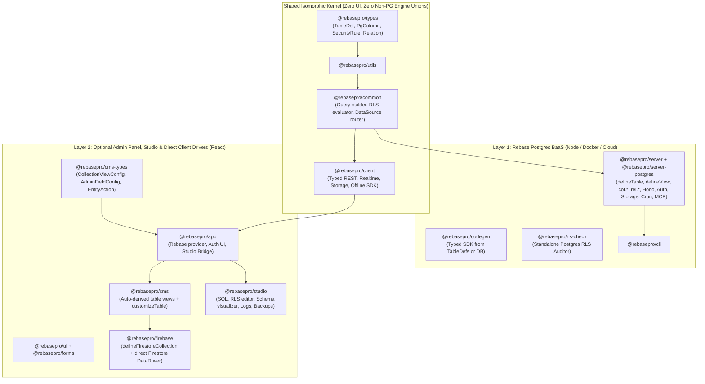
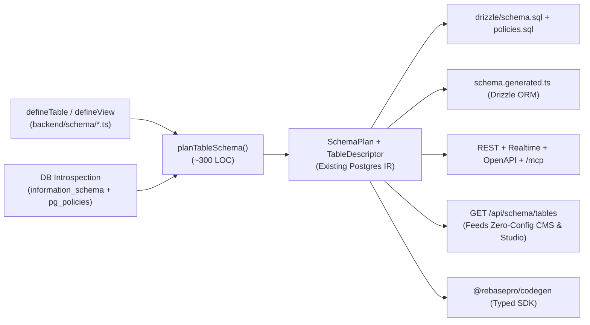

# Rebase Architecture Spec: Postgres-First BaaS Core + Optional CMS Layer

> **Status:** being implemented on branch `feat/postgres-first-baas`. Part I is the
> spec as given (2026-11-12), unchanged except that file links are written as
> paths. Part II records the decisions taken while building it and the checklist
> the work is ticked against.

# Part I — The spec

## 1. Purpose & Non-Negotiable Invariants

Rebase is transitioning from a CMS-originated unified `CollectionConfig` model to a **Postgres-native Backend-as-a-Service (BaaS) for Europe** with an **optional, strictly layered CMS and Studio** on top.

Every design choice in this specification is bound by five invariants:

1. **Zero Loss of Functionality:** Every capability supported today—Postgres column types, generated/identity columns, 5 relation kinds, junction `_pivot` payloads, full-text `tsvector` search, `pgvector` HNSW/IVFFlat indexes, S3/GCS/local storage fields, soft deletes, multi-tenant row stamping, entity history, field/row lifecycle hooks (including PII masking), SQL & materialized views, Studio visual editing, SDK codegen, MCP tools, and custom React CMS views/actions—must work with 1:1 parity.
2. **Mandatory Fail-Closed Security (RLS by Default):** Neither a human developer nor an AI agent may define or serve a Postgres table without an explicit Row-Level Security posture. Security lives in PostgreSQL (`ENABLE ROW LEVEL SECURITY` + `CREATE POLICY` executed under `SET LOCAL ROLE rebase_user`), never in application-memory filters.
3. **Pure Postgres Backend Core:** The backend runtime (`@rebasepro/server` + `@rebasepro/server-postgres`) has zero knowledge of UI labels, form widgets, React components, Firestore subcollections, or MongoDB document emulation. `@rebasepro/server-mongo` is retired.
4. **First-Class Hybrid Postgres + Firestore Support in the CMS:** Client-direct sources (`transport: "direct"`, specifically `@rebasepro/firebase`) remain first-class citizens in the CMS/frontend layer via `resolveDataSource` (`packages/common/src/data/resolveDataSource.ts`), including cross-source references between Firestore documents and Postgres tables.
5. **Automated Migration Path:** Existing `config/collections/*.ts` projects (including `app/` and existing client projects) migrate deterministically via a `ts-morph` codemod in `tooling/scripts/`.

---

## 2. Package & Dependency Topology

> **Important.** The core inversion: **Tables** belong to the BaaS (`backend/schema/`). **Collections** belong to the CMS (`frontend/cms/`). A Postgres table automatically projects into a default CMS collection over the wire with zero frontend config; `frontend/cms/` only states deltas (icons, Kanban, custom React components, enum colors) plus client-only sources like Firestore.



### Structural Cleanups Unlocked Immediately

| Today's Friction | Under This Spec |
|---|---|
| `config/collections/*.ts` shared by Node and Vite; requires `/// <reference types="@rebasepro/cms-types" />` interface merging | **Deleted.** Backend reads `backend/schema/*.ts` (`defineTable`). Frontend optionally reads `frontend/cms/*.tsx` (`customizeTable`) with standard ES imports. |
| Custom React fields require lazy string paths or `() => import(...)` thunks + `pnpm check:headless` loader guards | **Deleted.** `frontend/cms/*.tsx` runs only in Vite/React and imports `<CustomField />` directly by value. |
| `packages/types/src/types/properties.ts` carries `FirebaseProperties`, `MongoProperties`, `DistributiveOmit<..., SqlColumnFields>`, and `type: "string"` for UUIDs | **Deleted from `@rebasepro/types`.** Backend columns map 1:1 to PostgreSQL types (`PgType`, `packages/server-postgres/src/schema/plan/types.ts`). Firestore types move into `@rebasepro/firebase`. |
| `@rebasepro/server-mongo` evaluates partial `securityRules` in JS memory | **Retired.** Every backend data route is backed by real PostgreSQL RLS. |

---

## 3. Project Directory Layout

A project adopts one of two layouts depending on whether it uses the CMS:

```text
# Mode A: Pure BaaS (API + Auth + Storage + Realtime + MCP)
my-backend/
├── backend/
│   ├── schema/               # Optional! Omit for pure DB-introspection mode
│   │   ├── index.ts          # Exports tables + optional defaultRls
│   │   ├── users.ts          # defineAuthTable(...)
│   │   └── posts.ts          # defineTable("posts", ...)
│   ├── functions/            # Custom Hono routes
│   ├── crons/                # Scheduled jobs
│   └── drizzle/              # Generated schema.sql + policies.sql
└── rebase.json

# Mode B: BaaS + Optional CMS / Studio (+ Optional Firestore)
my-app/
├── backend/                  # Identical to Mode A — zero CMS files!
│   └── schema/
├── frontend/
│   └── src/
│       ├── cms/              # Optional UI overrides & direct client collections
│       │   ├── posts.tsx     # customizeTable(posts, { ... }) — real JSX imports allowed
│       │   └── events.ts     # defineFirestoreCollection({ ... }) — client-direct
│       └── App.tsx
└── rebase.json
```

> **Note.** `app/config/` as a third separate TypeScript workspace (`tsconfig.json` + `admin.d.ts` + `frontend-assets.d.ts`) is **no longer needed**. `frontend` can import table symbols (`import type { posts }` or pure schema metadata) from `backend/schema`, while `backend` never imports anything from `frontend`.

---

## 4. Layer 1 Spec: BaaS Schema & Security API (`@rebasepro/server`)

### 4.1 `defineTable`, `defineAuthTable`, and `defineView`

```ts
// backend/schema/posts.ts
import { defineTable, col, rel } from "@rebasepro/server/schema";
import { users } from "./users";
import { tags } from "./tags";

export const posts = defineTable("posts", {
    // Optional overrides (table defaults to "posts", schema defaults to "public", slug defaults to "posts")
    slug: "posts",
    schema: "public",

    columns: {
        id:          col.uuid().primaryKey().defaultRandom(),
        title:       col.text().notNull().validate({ min: 3, max: 200 }),
        slug:        col.varchar(160).notNull().unique(),
        status:      col.enum(["draft", "needs_review", "published", "archived"]).notNull().default("draft"),
        heroImage:   col.storage({ path: "posts/heroes/", accept: ["image/*"], maxBytes: "10MB" }),
        embedding:   col.vector(1536, { index: { method: "hnsw", metric: "cosine" } }),
        metadata:    col.jsonb<{ seoTitle?: string; canonicalUrl?: string }>(),
        publishDate: col.timestamptz(),
        orgId:       col.uuid().notNull(),
        createdAt:   col.timestamptz().notNull().onCreateNow(),
        updatedAt:   col.timestamptz().notNull().onUpdateNow(),
        deletedAt:   col.timestamptz(),
        __order:     col.text(),
    },

    relations: {
        author: rel.belongsTo(() => users, {
            // Creates FK column `author_id` (or binds to an explicit column in `columns`) + btree index
            localKey: "author_id",
            notNull: true,
            onDelete: "restrict",
        }),
        tags: rel.manyToMany(() => tags, {
            through: "posts_tags",
            pivot: {
                addedBy: col.uuid(),
                sortOrder: col.integer().default(0),
            },
        }),
    },

    // MANDATORY: omitting `rls` is a compile-time error AND a boot-time error.
    rls: [
        { operation: "select", access: "public", condition: { status: "published" } },
        { operations: ["select", "insert", "update"], roles: ["editor"] },
        { operation: "delete", roles: ["admin"] },
    ],

    // Built-in Postgres capabilities (1:1 with current PostgresCollectionConfig)
    tenant:     { field: "orgId", from: { claim: "org_id" } },
    softDelete: { field: "deletedAt" },
    history:    true,
    search:     { fields: ["title"], language: "english" },
    indexes:    [{ columns: ["orgId", "status", "publishDate"] }],

    hooks: {
        beforeSave: ({ values, previousValues }) => {
            const merged = { ...previousValues, ...values };
            if (typeof merged.title === "string" && !merged.slug) {
                values.slug = merged.title.toLowerCase().replace(/[^a-z0-9]+/g, "-").replace(/(^-|-$)/g, "");
            }
            return values;
        },
        afterRead: ({ values, context }) => {
            // Full parity with current PII masking (`maskValues`) across REST, Realtime & MCP
            return values;
        },
    },
});
```

### 4.2 Complete Column Builder Surface (`col.*`)

Every member of `PgType` (`packages/server-postgres/src/schema/plan/types.ts`) and every current `Property` capability maps cleanly without UI noise:

| Builder | Postgres Type | Supported Modifiers & Capabilities |
|---|---|---|
| `col.uuid()` | `UUID` | `.primaryKey()`, `.defaultRandom()` (`gen_random_uuid()`), `.notNull()`, `.unique()` |
| `col.text()` | `TEXT` | `.validate({ min, max, matches, email, url, lowercase, trim })`, `.transform({ beforeSave, afterRead })` |
| `col.varchar(n)` / `col.char(n)` | `VARCHAR(n)` / `CHAR(n)` | Same string validations + length enforced at API & DDL |
| `col.enum(values, opts?)` | `CREATE TYPE ... AS ENUM` | Typed literal union `T[number]`; optional shared enum `name` |
| `col.smallint()` / `col.integer()` / `col.bigint()` | `SMALLINT` / `INTEGER` / `BIGINT` | `.identity()` (`GENERATED BY DEFAULT AS IDENTITY`), `.validate({ min, max, integer })` |
| `col.serial()` / `col.bigserial()` | `SERIAL` / `BIGSERIAL` | Legacy serial support for existing schemas |
| `col.real()` / `col.doublePrecision()` / `col.numeric(p?, s?)` | `REAL` / `DOUBLE PRECISION` / `NUMERIC(p,s)` | `.validate({ min, max })` |
| `col.boolean()` | `BOOLEAN` | `.default(true \| false)` |
| `col.timestamptz()` / `col.date()` / `col.time()` | `TIMESTAMPTZ` / `DATE` / `TIME` | `.onCreateNow()`, `.onUpdateNow()` (`BEFORE UPDATE` trigger + driver stamp) |
| `col.jsonb<T>()` / `col.json<T>()` | `JSONB` / `JSON` | Full static TypeScript inference for `T`; optional JSON schema validation |
| `col.array(innerCol)` | `T[]` (e.g., `TEXT[]`, `UUID[]`) | `.validate({ minItems, maxItems, uniqueItems })` |
| `col.vector(dims, opts?)` | `vector(dims)` (`pgvector`) | `{ index: { method: "hnsw" \| "ivfflat", metric: "cosine" \| "l2" \| "ip" } }` |
| `col.bytea()` | `BYTEA` | Base64/binary wire codec preserved |
| `col.geopoint()` | `JSONB` / tuple `{ lat, lng }` | Preserves existing geopoint wire compatibility |
| `col.storage(opts)` | `TEXT` (or `TEXT[]` with `.multiple()`) | `{ source, path, accept, maxBytes, imageResize }` — binds directly to S3/GCS/Local storage lifecycle, orphan sweeps, and signed URLs |

**Universal column modifiers on every `col.*`:**

* `.column("legacy_col_name")` — overrides default `snake_case(key)` SQL column mapping while keeping `key` as the JSON/SDK property name.
* `.notNull()` — Columns are **nullable by default** (matching SQL and Drizzle conventions!) unless `.notNull()` or `.primaryKey()` is called. *(Note: eliminates today's confusing `validation: { required: true }` vs SQL `NOT NULL` split.)*
* `.unique()` — Single-column unique constraint.
* `.default(literal)` / `.defaultSql("gen_short_id()")` — Compiles directly to `ColumnDefault` (`packages/server-postgres/src/schema/plan/types.ts`).
* `.generatedAs(sqlExpr)` — `GENERATED ALWAYS AS (...) STORED`.
* `.readOnly()` — Rejects client writes on `create`/`update` at the API boundary (while allowing DB defaults/triggers).
* `.transform({ beforeSave, afterRead })` — Field-level hooks (e.g. `value.trim()`), preserving today's `PropertyCallbacks`.

### 4.3 All 5 Relations (`rel.*`)

All five relation kinds in `packages/types/src/types/relations.ts` are preserved verbatim with circular-import-safe target thunks:

* `rel.belongsTo(() => target, { localKey?, notNull?, onDelete?, onUpdate?, index? })` — Declares or binds to a local FK column; auto-creates btree index unless `index: false`.
* `rel.hasOne(() => target, { foreignKey })` — Target table holds unique FK.
* `rel.hasMany(() => target, { foreignKey, orderBy? })` — Target table holds FK.
* `rel.manyToMany(() => target, { through?, sourceKey?, targetKey?, pivot? })` — Auto-provisions junction table + RLS on junction table + `_pivot` read/write support.
* `rel.via(() => target, { steps: [...] })` — Multi-hop read-only traversal.

### 4.4 Mandatory Security Model (`rls` by Default)

> **Warning — Security Invariant:** A table can never accidentally become public or unprotected. Every path into Rebase enforces RLS fail-closed.

1. **In `defineTable`:** `rls` is a **required property** on the TypeScript interface (not optional!). Three explicit values are accepted:
   * `rls: "admin-only"` — Enables RLS on the table and generates only the baseline `default_admin` policy (only `admin` role and server-internal `dataAsAdmin` can access rows; ordinary authenticated and anonymous callers get 0 rows / 403).
   * `rls: [ ...SecurityRule[] ]` — Explicit permissive/restrictive rules (`ownerField`, `access: "public" | "authenticated"`, `roles`, structured `condition`/`check`, or raw SQL `using`/`withCheck` with `rebase.uid()`, `rebase.roles()`, `rebase.jwt()`).
   * `rls: "inherit"` — Explicitly opts into `defaultRls` exported from `backend/schema/index.ts`. (If `"inherit"` is used and `backend/schema/index.ts` exports no `defaultRls`, `rebase db generate` and server boot fail hard.)
2. **In `defineAuthTable`:** Automatically injects self-read (`id = rebase.uid()`) and admin-only privilege-column protection (`roles` cannot be self-escalated), matching today's auth table guarantees.
3. **In `defineView`:**
   * Standard view (`materialized: false`): Created with `WITH (security_invoker = true)` so underlying base tables' RLS policies govern every query automatically.
   * Materialized view (`materialized: true`): Requires explicit `roles: string[]` (defaults to `["admin"]`) since Postgres cannot attach row policies to materialized views.
4. **In Zero-Config DB Introspection Mode (no `backend/schema/`):** Unchanged from `docs/MODULAR-ARCHITECTURE.md`—any table without `ENABLE ROW LEVEL SECURITY` is skipped at boot and prints the exact `ALTER TABLE ... ENABLE ROW LEVEL SECURITY` remediation SQL.

---

## 5. Compiler & Wire Bridge (Why Nothing Breaks Internally)

Because `packages/server-postgres/src/schema/plan/types.ts` already isolated a clean `SchemaPlan` (`TablePlan`, `ColumnPlan`, `PgType`, `ForeignKeyPlan`), **95% of `@rebasepro/server-postgres` stays intact**:



### Public Schema Metadata Endpoint (`GET /api/schema/tables`)

For authenticated callers (or Studio/CMS), the backend exposes its normalized `TableDescriptor[]` JSON (columns, `PgType` tags, nullability, enum literals, storage rules, relations, and structured `rls` expressions—never server hook source code).

This single wire payload powers **three** consumers with zero duplicate config files:

1. **Zero-Config `<RebaseCMS />`** — Renders every Postgres table immediately without a single frontend config file.
2. **`<RebaseStudio />`** — Renders the Schema Visualizer, SQL autocomplete, API Explorer, and RLS Policy Editor.
3. **Hosted & Local MCP (`show_collection` / `@rebasepro/mcp-apps`)** — Renders interactive table/form UIs inside Claude directly from the table descriptor.

---

## 6. Layer 2 Spec: Optional CMS & Hybrid Firestore Support

### 6.1 Zero-Config Defaults (Postgres Tables -> CMS Views)

When `<RebaseCMS />` mounts connected to `rebaseClient`, every table from `GET /api/schema/tables` automatically receives sensible UI defaults:

* **Labels:** `first_name` / `firstName` -> `"First Name"`; table `order_items` -> `"Order Items"` (singular `"Order Item"`).
* **Widgets from `PgType` + Metadata:**
  * `col.text()` / `col.varchar()` -> Text input (or URL/Email input if `.validate({ url: true })` / `{ email: true }`)
  * `col.enum([...])` -> Select / Status badge chip (deterministic palette color assigned per enum value unless overridden)
  * `col.storage(...)` -> Drag-and-drop upload field with preview & accept/size validation
  * `col.timestamptz()` / `col.date()` -> Date-time / Date picker (`createdAt`/`updatedAt` auto-marked `readOnly` & hidden from default table columns)
  * `col.jsonb()` -> Structured JSON editor
  * `rel.belongsTo` / `rel.manyToMany` -> Relation reference picker & entity drawer sub-tabs (`hasMany` / `manyToMany`)
* **Client-Side Permission Reflection:** Structured `rls` rules are evaluated client-side (using your existing policy evaluator) so "Create", "Edit", and "Delete" controls hide automatically when the signed-in role lacks permission.

### 6.2 Customizing Postgres Tables in the CMS (`customizeTable`)

When a project wants rich back-office ergonomics (like `app/config/collections/posts.ts`), it adds a frontend-only file in `frontend/src/cms/`:

```tsx
// frontend/src/cms/posts.tsx
import { customizeTable, updateRecord } from "@rebasepro/cms";
import type { posts } from "../../../backend/schema/posts";
import { CustomMarkdownEditor } from "../components/CustomMarkdownEditor";

export const postsCms = customizeTable<typeof posts>("posts", {
    name: "Blog Posts",
    singularName: "Blog Post",
    icon: "FileText",
    group: "Content",

    // View modes
    defaultViewMode: "cards",
    enabledViews: ["table", "cards", "kanban"],
    kanban: { columnField: "status", orderField: "__order" },

    // Card / List slot mapping
    display: {
        title: "title",
        image: "heroImage",
        status: "status",
        date: "publishDate",
    },

    // Per-column UI overrides (type-checked against `typeof posts` columns & relations!)
    fields: {
        status: {
            // UI presentation labels & colors live HERE in the CMS, not in the DB schema!
            enumLabels: {
                draft:        { label: "Draft", color: "gray" },
                needs_review: { label: "Needs Review", color: "orange" },
                published:    { label: "Published", color: "green" },
                archived:     { label: "Archived", color: "red" },
            },
        },
        title:   { multiline: true },
        content: { Field: CustomMarkdownEditor }, // Direct React component import!
        orgId:   { hidden: true },
        __order: { hidden: true, disabled: true },
    },

    // Custom toolbar / row actions
    entityActions: [
        {
            key: "publish",
            name: "Publish",
            icon: "Send",
            collapsed: false,
            isEnabled: ({ row }) => row?.status !== "published",
            onClick: ({ id, context }) =>
                updateRecord(context, "posts", id, { status: "published", publishDate: new Date().toISOString() }, "Published"),
        },
    ],
});
```

### 6.3 First-Class Hybrid Postgres + Firestore (`@rebasepro/firebase`)

Your client project running **both Postgres and Firestore** works cleanly without leaking a single Firestore type into `@rebasepro/server`:

1. **`@rebasepro/firebase` owns `defineFirestoreCollection`:**
   * Supports Firestore-native concepts: `path`, `subcollections: () => [...]`, `FirebaseProperties` (`string`, `number`, `boolean`, `date`, `map`, `array`, `geopoint`, `reference`), and Firestore security-rule awareness.
2. **Unified Mounting & Cross-Engine References in `<Rebase>`:**

```tsx
// frontend/src/App.tsx — Hybrid Postgres + Firestore App
import { Rebase, RebaseAuth } from "@rebasepro/app";
import { RebaseCMS, RebaseShell } from "@rebasepro/cms";
import { RebaseStudio } from "@rebasepro/studio";
import { useFirestoreDataSource, defineFirestoreCollection } from "@rebasepro/firebase";
import { postsCms } from "./cms/posts";

const firestoreEvents = defineFirestoreCollection({
    slug: "fs_events",
    path: "events",
    name: "Live Events (Firestore)",
    dataSource: "firestore",
    fields: {
        type:       { name: "Event Type", type: "string", required: true },
        payload:    { name: "Payload", type: "map" },
        // Cross-engine reference! Points to the `users` Postgres BaaS table:
        customerId: { name: "Customer", type: "reference", target: "customers" },
    },
    subcollections: () => [eventTracesFirestoreCollection],
});

export function App() {
    const firestoreSource = useFirestoreDataSource({ key: "firestore", firebaseApp });

    return (
        <Rebase
            client={rebaseClient}          // Default data source → Postgres BaaS
            dataSources={[firestoreSource]} // Secondary direct data source → Firestore
            authController={authController}
        >
            <RebaseAuth />
            <RebaseCMS
                // Auto-discovers all Postgres tables from `rebaseClient`, merges `postsCms`,
                // and mounts `firestoreEvents` side-by-side in the same navigation & reference router!
                tableCustomizations={[postsCms]}
                externalCollections={[firestoreEvents]}
            />
            <RebaseStudio />
            <RebaseShell title="Acme Ops" />
        </Rebase>
    );
}
```

* When an operator opens `fs_events` (Firestore) and clicks the `customerId` reference chip, `resolveDataSource("customers", registry)` (`packages/common/src/data/resolveDataSource.ts`) routes that lookup to `rebaseClient` (Postgres BaaS under RLS).
* Conversely, a Postgres table with a `col.text()` holding a Firestore document ID can be decorated in `customizeTable` with `fields: { firestoreDocId: { referenceTo: "fs_events" } }`, routing the preview drawer to `firestoreSource`!

### 6.4 Studio Visual Schema Editor (`SchemaSourceEditor`)

Today, `SchemaSourceEditor` (`packages/server/src/schema-edit/source-editor.ts`) uses `ts-morph` to mutate `config/collections/*.ts` with both SQL schema edits and `admin: { ... }` UI tweaks.

Under the split:

* **`/api/schema-editor/*` (Backend AST Editor)** reads and writes **`backend/schema/*.ts` (`defineTable` / `rls` / `col.*` / `rel.*`) only**. Because `defineTable` is a flat, regular builder DSL without JSX/thunks/enum colors, the `ts-morph` writer becomes dramatically simpler and more reliable.
* **UI Layout Persistence** (column widths, hidden columns, default view mode changed in Studio) either writes to a clean JSON/TS UI config in dev mode or persists to user/workspace view preferences in `rebase.ui_preferences` when running in deployed/headless environments where frontend source files aren't on disk!

---

## 7. Complete Capability Parity Check

| Capability | Current (`CollectionConfig`) | New Spec (`defineTable` + `customizeTable`) | Status |
|---|---|---|---|
| Postgres DDL & Drizzle `schema.generated.ts` | `planSchema(collections)` | `planSchema(tables)` (same `SchemaPlan` IR) | **100% Parity** |
| Fail-closed Postgres RLS + `policies.sql` | Optional `securityRules` + directory fallback | **Required** `rls` key (`"admin-only"` \| `"inherit"` \| `SecurityRule[]`) | **Stronger** |
| Headless DB Introspection (`--headless`) | `introspectCollections` | `introspectTables` (refuses tables without RLS) | **100% Parity** |
| All 5 Relations + `_pivot` + `_count` | `Property(relation)` + `relations[]` | Unified `relations: { ... }` block with `rel.*` | **Cleaner, 100% Parity** |
| Multi-tenancy (`tenant`), `softDelete`, `history` | Top-level keys on `PostgresCollectionConfig` | Top-level keys on `defineTable` | **100% Parity** |
| Full-text `search` (`tsvector`) & `pgvector` | `search` + `VectorProperty` | `search` + `col.vector(dims, opts)` | **100% Parity** |
| S3/GCS Storage uploads, resizing & orphan sweep | `StringProperty.storage` | `col.storage({ ... })` | **100% Parity** |
| Row & Field Hooks + PII Masking | `callbacks` + `Property.callbacks` | `hooks` + `col.transform(...)` | **100% Parity** |
| SQL Views & Materialized Views | `PostgresCollectionConfig.view` | Dedicated `defineView(name, { query, materialized, roles })` | **Cleaner, 100% Parity** |
| Auth Tables (OAuth, MFA, Magic Link, API Keys) | `auth: true \| AuthCollectionConfig` | `defineAuthTable("users", { ... })` | **Cleaner, 100% Parity** |
| Typed SDK Codegen (`rebase generate-sdk`) | Reads `config/collections` | Reads `backend/schema` (or live DB introspection) | **100% Parity** |
| Remote `/mcp`, Local MCP, `plugin-review`, `mcp-apps` | Built on REST/DataDriver + RLS | Unchanged; operates on `TableDescriptor` under RLS | **100% Parity** |
| Kanban, Spreadsheet, Cards, Custom React Fields/Actions | `admin: { ... }` with lazy import thunks | `customizeTable` in `frontend/` with native React imports | **Simpler, 100% Parity** |
| Hybrid Postgres + Firestore App | Shared `CollectionConfig` union | `defineTable` (PG) + `defineFirestoreCollection` (`@rebasepro/firebase`) | **100% Parity** |

---

## 8. Phased Execution Plan & Migration Codemod

> **Tip.** Because `defineTable` compiles to the exact same internal `TablePlan` / `SchemaPlan` and runtime driver structures, we do **not** need a risky "big bang" rewrite. We can ship this in 4 clean, verifiable phases.

1. **Phase 1 — Retire `@rebasepro/server-mongo` & Isolate Firestore to `@rebasepro/firebase`:**
   * Remove `packages/server-mongo` and strip `MongoProperties` / `MongoDBCollectionConfig` from `@rebasepro/types`.
   * Move `FirebaseCollectionConfig`, `FirebaseProperties`, and `subcollections` out of `@rebasepro/types` into `@rebasepro/firebase` + `@rebasepro/cms-types`.
2. **Phase 2 — Ship `defineTable`, `defineAuthTable`, `defineView`, `col.*`, `rel.*`:**
   * Implement the `defineTable` builder in `@rebasepro/types` / `@rebasepro/server` with mandatory `rls`.
   * Write the ~300-line adapter from `TableDef` -> `SchemaPlan` + runtime `TableDescriptor` (`GET /api/schema/tables`), keeping full test coverage across `server-postgres` and `rls-check`.
3. **Phase 3 — Ship Zero-Config `<RebaseCMS />` + `customizeTable` + Codemod:**
   * Teach `@rebasepro/cms` to hydrate default collections from `GET /api/schema/tables`, layered with `tableCustomizations={[...]}` and `externalCollections={[...]}`.
   * Build `tooling/scripts/migrate-collections-to-tables.mts` (`ts-morph`): automatically splits any existing `config/collections/*.ts` file into `backend/schema/<table>.ts` (`defineTable`) + `frontend/src/cms/<table>.tsx` (`customizeTable`, emitted *only* if the collection actually had non-default `admin` customizations!) + `defineFirestoreCollection` for `engine: "firestore"`.
   * Run the codemod on `app/` and verify all unit + Playwright E2E lanes pass.
4. **Phase 4 — Remove Legacy `defineCollection` Backend Loader & Headless Guards:**
   * Update CLI templates (`rebase init` and `rebase init --headless`), `SchemaSourceEditor`, SDK codegen, docs, and `llms.txt`.
   * Delete obsolete React-in-backend guard complexity (`admin.d.ts` declaration merging, Vite string-to-lazy-import rewriter).

---

## 9. Open Decisions for Review

1. **Naming of the BaaS entry point & package:**
   Should `defineTable`, `col`, `rel` be imported from `@rebasepro/server/schema` (keeping package names unchanged per repo rules), or from `@rebasepro/types` / `@rebasepro/common` so isomorphic tools can import schema files without installing `@rebasepro/server`? *(Recommendation: `@rebasepro/types` or `@rebasepro/common`, re-exported by `@rebasepro/server`, so `frontend` or `codegen` can import `typeof posts` with zero server runtime deps.)*
2. **Drizzle Interop vs. `defineTable`:**
   Do you like the dedicated `defineTable` + `col.*` builder shown in §4.1 (which keeps `rls`, `storage`, `tenant`, `hooks`, `search`, and `vector` in one cohesive TypeScript object), **or** would you prefer users to write raw Drizzle `pgTable(...)` for columns and pass that `pgTable` into `defineTable(postsTable, { rls, hooks, storage, ... })`?
3. **BelongsTo Foreign Key Style:**
   In `defineTable`, do you prefer declaring foreign keys inside `relations: { author: rel.belongsTo(() => users) }` (which generates `author_id` automatically), or right inside `columns: { authorId: col.belongsTo(() => users).notNull() }` so every physical column on the table is visible in `columns`?

---

# Part II — Decisions and checklist

Every entry names what was decided and why. Entries marked **(gap)** add
something the spec's surface does not show, because invariant 1 (zero loss)
cannot hold without it; they are additions in the spec's own style, never
substitutions. Entries marked **(unsure)** are the ones to review first.

## A. The three open decisions (§9)

- **D1 — entry point.** The builders (`defineTable`, `defineAuthTable`,
  `defineView`, `col`, `rel`, `json`) and every authoring/wire type live in
  `@rebasepro/types` (dependency-free, isomorphic). The compiler
  (`TableDef → TableDescriptor`) lives in `@rebasepro/common`, because it needs
  the naming helpers in `@rebasepro/utils`. `@rebasepro/server` re-exports the
  builders from its root and from the subpath `@rebasepro/server/schema` (a tiny
  entry that loads nothing of the server), so the spec's import line works
  verbatim and a frontend can `import type { posts }` with no server runtime.
- **D2 — builder.** The dedicated `defineTable` + `col.*` builder of §4.1. No
  Drizzle `pgTable` interop.
- **D3 — foreign keys.** Declared in `relations: { author: rel.belongsTo(...) }`
  as in §4.1. A `belongsTo` *binds* to a column in `columns` whose SQL name is
  its `localKey` when one exists, and otherwise *derives* the column (appended
  after the declared ones, wire key = camelCase of the column, as today). The
  codemod always writes the bound column explicitly at its original position,
  so migrated projects generate byte-identical SQL and every physical column is
  visible in `columns`.

## B. Authoring surface — the complete contract

Column spelling follows Drizzle's pg-core since 2026-11-13 — see `drizzle-alignment`.

Authoritative source: `packages/types/src/schema/`. Summary:

### `defineTable(name, config)`

| Key | Meaning |
|---|---|
| `name` (1st arg) | Default for both the SQL table and the API slug. |
| `table?`, `slug?`, `schema?` | Overrides. `schema` defaults to `public`. The codemod writes `slug` whenever it differed from the table: foreign-key and junction names derive from the slug today and must not move. |
| `database?` **(gap)** | Key of a non-default Postgres database declared in `backend/resources.ts` (was `dataSource`). |
| `description?` **(gap)** | Shown in OpenAPI and MCP tool descriptions (was `name`/`description`). Not a UI label. |
| `columns` | `col.*` builders, in physical order. At least one `.primaryKey()`; several make a composite key in declaration order. No implicit `id` column any more. |
| `relations?` | `rel.*` builders; the key is the relation name. |
| `rls` | **Required.** `"admin-only"`, `"inherit"`, or a non-empty `SecurityRule[]`. `[]` is refused: say `"admin-only"`. |
| `defaultPolicies?: false` **(gap)** | Explicit rules *without* the injected admin baseline (was `disableDefaultPolicies`). Refused together with `"admin-only"` (that would deny everyone). |
| `tenant?`, `softDelete?`, `history?`, `search?`, `indexes?` | As today. `indexes[].columns` (spec name) replaces `on`; each entry is a column key or `{ column, direction?, nulls? }`; `where`, `unique`, `using`, `include`, `reason` unchanged. |
| `hooks?` | All seven: `beforeQuery`, `afterRead`, `beforeSave`, `afterSave`, `afterSaveError`, `beforeDelete`, `afterDelete`. Props carry `table` (the descriptor) instead of `collection`; `afterRead` receives `values`. |
| `strictWrites?: false` **(gap)** | Accept writes to columns the table does not declare (was `strictWrites`). |
| `metadata?` **(gap)** | Opaque, served on the wire. |

`defineAuthTable(name, config)` = the same plus `auth?: { roles, scopes,
personalKeys, onCreateUser, onResetPassword }`; injects self-read, the
admin-write gate and the auth columns. `defineView(name, { query, materialized?,
roles?, columns, schema?, slug?, indexes? })`.

### `col.*`

Every builder of §4.2, plus `col.smallserial()` (it is a `PgType` member),
spelled as Drizzle's `pg-core` spells it: an optional SQL column name first,
then Drizzle's config object, then the chain. §4.2's spellings map to:

| §4.2 | Canonical |
|---|---|
| `.column("legacy_col_name")` | the builder's leading argument: `col.text("legacy_col_name")` |
| `col.varchar(n)` / `col.char(n)` | `col.varchar({ length: n })` / `col.char({ length: n })` — the length is required |
| `col.enum(values, { name })` | `const status = pgEnum(name, values)`, then `status()`; `col.enum(values)` (type `<table>_<column>`) unchanged |
| `col.bigint()` / `col.bigserial()` | `col.bigint({ mode: "number" })` / `col.bigserial({ mode: "number" })` |
| `col.numeric(p?, s?)` | `col.numeric({ precision, scale })` (`col.decimal` is an alias) |
| `col.timestamptz()` | `col.timestamp({ withTimezone: true })` |
| `col.jsonb<T>()` / `col.json<T>()` | `col.jsonb().$type<T>()` / `col.json().$type<T>()` |
| `col.array(innerCol)` | `innerCol.array()` — item rules before `.array()`, column modifiers after |
| `col.vector(dims, opts?)` | `col.vector({ dimensions, index? })` |
| `.defaultSql("gen_short_id()")` | `` .default(sql`gen_short_id()`) ``; `.defaultNow()` is `` .default(sql`now()`) `` |
| `.generatedAs(sqlExpr)` | `` .generatedAlwaysAs(sql`…`) `` |
| `.identity()` | `.generatedByDefaultAsIdentity()` |
| — | `col.custom({ dataType: "inet" })` for a type no builder names |

A Drizzle spelling that would mean something else here does not compile, with
a message saying what to write (`col.timestamp()` without time zone,
`.references()` — a foreign key is a `rel.belongsTo` —, `.$defaultFn()`,
`.generatedAlwaysAsIdentity()`, `numeric`'s `mode: "string"`, …).

Universal modifiers of §4.2, plus **(gap)**:

| Modifier | Replaces |
|---|---|
| `.access({ read?, write? })` | `access` — per-role column access, enforced on every door. |
| `.private()` | `excludeFromApi` — never on the wire, in the SDK or in OpenAPI. |
| `.onCreateUser()` / `.onUpdateUser()` | `autoValue: "user_on_create" \| "user_on_update"`. |
| `.dbDefault()` | `databaseDefault: true` — the database owns a default Rebase does not state. |
| `.describe(text)` | Column description for OpenAPI/MCP. |
| `.oneOf([...])` | A closed value set that is *not* a Postgres enum type, on a number column. On text it is Drizzle's `col.text({ enum: [...] })`, also for `TEXT[]` of known strings (`col.text({ enum: [...] }).array()`). |
| `.validate({...})` extras | `length`, `uppercase`, `lessThan`, `moreThan`, `positive`, `negative`, date `min`/`max`, `requiredMessage`, `matchesMessage`, `uniqueItems`. |
| `col.vector({ dimensions, index })` | `index.metric` may be an array (one index per metric); `m`, `efConstruction`, `lists` kept; `index: false` kept. `"ip"` is today's `inner_product`. |
| `col.storage({...})` extras | `public`, `fileName` (template), `metadata`, `includeBucketUrl`, `storeUrl`. Browser-only options (`processFile`, `postProcess`, `previewUrl`, function-valued paths) move to `customizeTable`. |

`.notNull()` is exactly today's `validation.required` (NOT NULL and "required"
in the API). `.default(v)` is a DDL default *and* applied by the driver, as
today. Stamp columns stay nullable unless `.notNull()` is written.

### `json.*` **(gap)** — nested JSON shapes

`col.jsonb().$type<T>()` types a document statically; `col.jsonb(json.object({...}))`
also tells the server its shape, which today's nested `map.properties`,
`array.of` and `array.oneOf` do: per-field validation, defaults, stamps,
transforms, storage files inside blocks, search over JSON paths. Builders:
`json.object`, `json.array`, `json.oneOf` (typed blocks: `typeField`,
`valueField`, `variants`), `json.string`, `json.number`, `json.boolean`,
`json.date`, `json.geopoint`, `json.storage`, `json.unknown`; modifiers
`.required()`, `.validate()`, `.default()`, `.oneOf()`, `.onCreateNow()`,
`.onUpdateNow()`, `.transform()`.

### `rel.*`

As §4.3, plus **(gap)**: `sourceKey` on `hasOne`/`hasMany` (natural keys);
`unique` on `belongsTo`; `onDelete` on `manyToMany`; `cardinality` on `via`.
`orderBy` on `hasMany` is new with the spec and is implemented.

### `rls`

`SecurityRule` is today's type, verbatim — policy names are a hash of the rule
as written, so a migrated rule must not be reshaped by a single key. Two forms
the spec's example uses are added as *new* shapes with their own compilation:
a plain-object `condition`/`check` (`{ status: "published" }` = equality on
each key), and `access: "public" | "authenticated"` combined with `condition`.

## C. Project layout

- `backend/schema/index.ts` exports the tables and views, and optionally
  `defaultRls`. Index exports are authoritative; a `defineTable` in a sibling
  file that `index.ts` does not export is a boot and generate error.
- What else lived in `config/`: `backend/resources.ts` (databases, buckets,
  topics), `backend/storage.ts` (`storageAuthorize`), `backend/hooks.ts`
  (`hooks`: global table hooks), `backend/generated/register.ts`.
  `setCollectionCallbacks` becomes `setTableHooks(slug, hooks)`.
- `rebase.json`: new key `tables` (default `backend/schema`). `schema` keeps
  meaning the generated Drizzle file. Bundle manifest: `entry.tables`; bundle
  format 3, runtime contract 2. Older bundles are refused with a message that
  names the codemod.
- `frontend/src/cms/*.tsx` holds `customizeTable(...)` and
  `defineFirestoreCollection(...)`. A gate forbids a value import from
  `backend/**` in `frontend/**` (type imports only), which replaces what the
  Vite collections plugin did to keep server hooks out of the browser bundle.

## D. Inside the backend

- One internal model: `TableDescriptor` (wire-safe, Postgres-native columns)
  wrapped in a server-only `RuntimeTable` (descriptor + catalogue table + hooks
  + transforms). `GET /api/schema/tables` serves the descriptors, redacted per
  caller.
- The work is staged so the tree is green after every stage:
  1. **Stage A — the new front door.** `defineTable` compiles to a descriptor
     and is *lowered* into the planner's and runtime's current input, so SQL
     generation, boot and every route work unchanged. Golden files recorded
     from `main` prove byte-identical output. Loader, CLI, wire endpoint, CMS
     projection, `customizeTable`, Firestore isolation, codemod, templates,
     cloud and docs all build on this.
  2. **Stage B — the inside.** The runtime, the server and the planner move
     onto descriptors subsystem by subsystem; legacy test fixtures are *lifted*
     meanwhile and converted with the codemod; the CMS view-model types
     (`Property`, CMS `CollectionConfig`) move to `@rebasepro/cms-types`,
     Firestore's to `@rebasepro/firebase`; then the lowering, the lift and
     every legacy type are deleted from the kernel.
- The schema-version hash is computed over descriptors, so every project
  restamps once and every generated SDK is reported stale once.
- The server stops emitting the admin's view-model envelope
  (`{ __type: "date" }`, relation refs); the CMS builds it from the wire row and
  the descriptor.

## E. Things to review first (unsure)

1. **Branch, not `main`.** A push of `main` deploys the control plane, and this
   is a breaking change to every layer, so the work is on
   `feat/postgres-first-baas` (OSS and cloud repos), unpushed.
2. **Deployed tenants.** A tenant bundle built from `config/collections` does
   not boot on the new runtime; it must be rebuilt after running the codemod on
   its source. Nothing was deployed.
3. **Version.** Templates may only import what the pinned release exports, so
   the workspace version is bumped on the branch (no tag, no publish).
4. **Translations.** Rewritten docs pages lose their five translated copies
   (English is served as fallback) until they are re-translated, which needs
   the translation key in `website/.env`.
5. Every **(gap)** name above.

## F. Checklist

*(Ticked as slices land; the final report lists each line.)*
